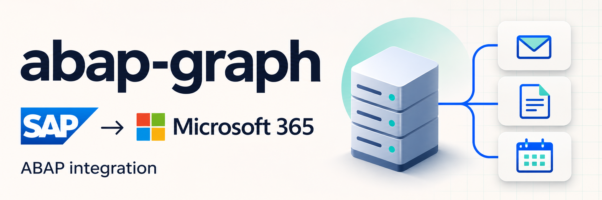
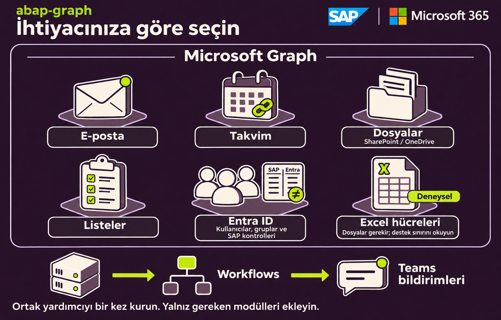
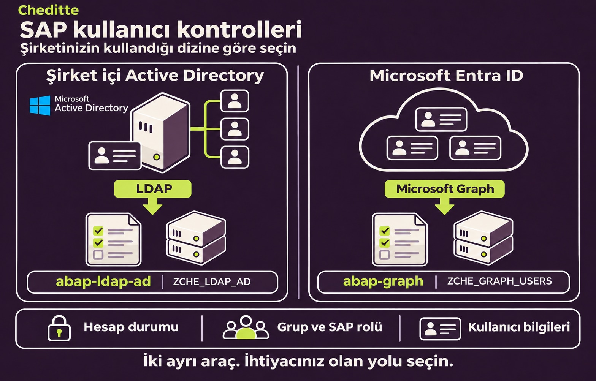

# abap-graph

> [English](README.md) | **Türkçe**

**SAP’den Microsoft 365 işlemleri yapın; SAP kullanıcılarını Entra ID ile karşılaştırın.**

Bu projeyi, SAP ile Microsoft 365 arasında çalışırken aynı bağlantı ve işlem kodlarını tekrar yazma ihtiyacını azaltmak için geliştirdim. Hazır programları ve gerekli dosyaları, kendi sisteminizde kullanıp uyarlayabilmeniz için bir araya getirdim.

**Yalnız ihtiyacınız olan bölümü kurun.** Örneğin Teams’e bildirim göndermek için e-posta veya Excel bölümünü kurmanız gerekmez. Hazır ekranlarda işlem yapabilir; bir ABAP geliştiricisiyle bunları kendi iş süreçlerinize bağlayabilirsiniz.

**[Görselli kurulum ve kullanım yol haritası →](WALKTHROUGH.tr.md)**

## Ne yapmak istiyorsunuz?

*Açıklayıcı çizimdir; test ekranı değildir. Teams bildirimleri ayrı Workflows yolunu kullanır. Excel hücre işlemlerinde [destek sınırını](docs/guides/excel.tr.md) okuyun.*

| İhtiyacınız | Başlayacağınız bölüm |
| --- | --- |
| SAP’den bir Teams kanalına bildirim göndermek | [Teams bildirimi](docs/guides/teams.tr.md) |
| Teams toplantı bağlantısı oluşturmak veya takvimi okumak | [Takvim ve toplantılar](docs/guides/calendar.tr.md) |
| Bir posta kutusundan e-posta göndermek veya gelenleri okumak | [E-posta](docs/guides/mail.tr.md) |
| SharePoint / OneDrive’a dosya yüklemek veya dosya indirmek | [Dosyalar](docs/guides/files.tr.md) |
| Var olan Excel dosyasının hücrelerini okumak veya değiştirmek | [Excel — destek sınırını okuyun](docs/guides/excel.tr.md) |
| SharePoint listesindeki kayıtlarla çalışmak | [Listeler](docs/guides/lists.tr.md) |
| Microsoft kullanıcılarını ve grup üyelerini listelemek | [Kullanıcılar ve gruplar](docs/guides/users.tr.md#ilk-liste) |
| SAP hesaplarını, rollerini ve kullanıcı bilgilerini Entra ID ile karşılaştırmak | [Yalnız raporlayan üç kontrol](docs/guides/users.tr.md#4-sap-ile-karşılaştırma) |

Graph karşılaştırmaları farkları gösterir; hesapları değiştirmez, rol atamaz.

## Active Directory mi, Entra ID mi?

**Şirket içi Active Directory:** ayrı `ZCHE_LDAP_AD` programını kullanın. **Buluttaki Microsoft Entra ID:** bu projedeki `ZCHE_GRAPH_USERS` programını kullanın. İkisi de SAP hesaplarını, grup–rol atamalarını ve iletişim bilgilerini gözden geçirmeye yardımcı olur. Örneğin dizindeki hesabı kapatılmış bir kişinin SAP kullanıcısı hâlâ açık olabilir.

Dizininize uygun aracı seçin; bu, iki dizini birlikte eşitleyen bir hizmet değildir. Active Directory deposu şu anda özeldir. [İzlenecek yol ve erişim durumu →](docs/guides/users.tr.md#dizin-türünü-seçin)

## Başlamak için üç hazırlık

1. **İşleminizi seçin.** Kullanacağınız posta kutusunu, dosyayı, siteyi veya Teams kanalını belirleyin.
2. **Erişimi hazırlayın.** Microsoft tarafında gerekli izinleri, SAP tarafında bağlantıyı tanımlayın. Yetkiler başka bir ekipteyse ilgili rehberi o ekiple paylaşın.
3. **Gereken dosyaları SAP’ye ekleyin.** Ortak yardımcı dosyayı ve seçtiğiniz bölümün dosyalarını kurun; ilk işlemi test ortamında deneyin.

Microsoft Graph, programların Microsoft 365 hizmetlerine erişmesini sağlayan arayüzdür. Bilgisayarınıza ayrıca Graph kurmazsınız. Teams kanal bildirimi ayrı bir İş Akışı bağlantısı kullanır; hangi hazırlıkların gerektiği her rehberde belirtilmiştir.

## Durum ve uyumluluk

| Konu | Durum |
| --- | --- |
| Kaynak sürümü | 0.8.0; henüz yayımlanmamış geliştirme sürümü |
| Denenen ortam | A4H/001, SAP_BASIS 816 ve Microsoft 365 test ortamı; kapsam sürüm ve işleme göre değişir |
| Eski SAP sistemleri | Klasik ABAP 7.00 sözdizimi hedeflenir; ECC 6.0’da henüz denenmedi |
| Excel hücre işlemleri | Kullanılan giriş yöntemi için Microsoft’un destek sınırlaması var; hazır `.xlsx` dosyalarını taşımak için Dosyalar bölümünü kullanabilirsiniz |

[Deneme sonuçları ve açık kalanlar →](VALIDATION.tr.md)

## Ayrıntılara geçmek isterseniz

- **Kurulum ve ilk kullanım:** [ekran görüntülü yol haritası](WALKTHROUGH.tr.md)
- **Alanlar, izinler ve kendi ABAP kodunuzda kullanım:** [teknik başvuru](TECHNICAL.tr.md)
- **Kaynak dosyalar:** [src klasörü](src)

---

[MIT lisansı](LICENSE) · [Hata bildirimi ve geri bildirim](https://github.com/Cheditte/abap-graph/issues)
