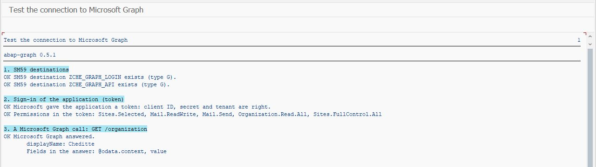
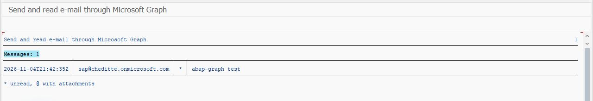
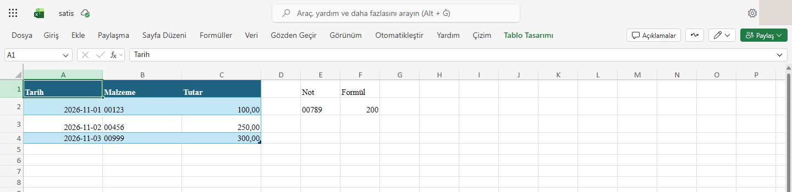

# Validation records

[Project overview](README.md) · [Setup roadmap](WALKTHROUGH.md) · [Technical reference](TECHNICAL.md)

**English** | [Türkçe](VALIDATION.tr.md)

This page records earlier tests, fixes between versions and the remaining validation gaps. Each result applies to the stated version and operation; tests were not rerun during this documentation update. The local source is recorded as version 0.8.0, not yet released; the group-and-role and SU01 comparisons added in 0.8.0 have not been tried in SAP yet.

## What has been verified

On an SAP ABAP Cloud Developer Trial 2025 (SAP_BASIS 816).

### Against a real Microsoft 365 tenant, 4 and 5 November 2026

A Microsoft 365 Business Basic test tenant, one app registration, the secret in SM59, the programs run from their selection screens.

> **Read this first:** besides `Organization.Read.All` and `Sites.Selected` (with `write` granted on one test site), the application also had **`Sites.FullControl.All`** during these tests. So the results show that the calls work. They do **not** show that `Sites.Selected` alone is enough, or that other sites and OneDrives stay closed. For e-mail and the calendar, the application had `Mail.Send`, `Mail.ReadWrite` and `Calendars.ReadWrite` for the whole tenant, without the [mailbox restriction described in the technical reference](TECHNICAL.md#what-the-e-mail-module-needs-in-addition).

- **Connection:** `ZCHE_GRAPH_CHECK` got a real token and called `GET /organization`, with the tenant given as domain and as GUID. A tenant that does not exist gave `AADSTS90002` and the hint.
- **Files:**
  - listing a folder;
  - a library by its name (`Belgeler`, the Turkish name of *Documents*), and the error that lists the libraries when the name is wrong;
  - creating a folder path twice, without a duplicate folder;
  - a folder name with Turkish letters and spaces;
  - a spool request uploaded as PDF (4,791 bytes) with `replace`, `rename` and `fail` (HTTP 409);
  - a file of 6,291,456 bytes downloaded to the application server, uploaded again in pieces and downloaded once more: the same SHA-256 every time.
- **Lists:**
  - lists and columns of a site, with internal names such as `M_x00fc__x015f_teriAd_x0131_` for "Müşteri Adı";
  - reading with chosen columns and a filter;
  - creating an item with text, number, yes/no, date and multiple choice;
  - refusing `12,5` as a number;
  - changing one field of an item;
  - update-or-create by `Title`, in both directions.
- **Excel, signed in as an application:** sheets and tables, reading a range as values and as shown text, writing values and a formula, reading a table, adding a row.
- **E-mail:** `ZCHE_GRAPH_MAIL` sent a short text mail from a shared mailbox to itself, then listed the unread mails of its inbox, with that mail in it.

- **Users and groups (5 November):** `ZCHE_GRAPH_USERS` listed the users, showed a shared mailbox's user (account disabled, as for every shared mailbox; no manager, no groups) and the members of a Microsoft 365 group by its name. The SAP account check read the users, but compared none: the SAP users of the trial have no e-mail address in SU01. The comparison itself is covered only by a unit test.
- **Calendar (5 November):** `ZCHE_GRAPH_CALENDAR` created an event from 10:00 to 10:30 (SAP time zone `TURKEY`) in a shared mailbox's calendar and listed it back with the same times. Run again with the same key, it got the same event back; the calendar still had one.
- **Teams meetings and free time (5 November, 0.7.0):** in a licensed user's calendar, a weekly Teams meeting twice, without attendees: both occurrences came back with the join link, then the series was deleted. The free-time search found 09:00–09:30 for two mailboxes, and no time in the half hour of the meeting.
- **Calendar again, 0.7.2 (5 November):** a weekly Teams meeting twice, 15:00–15:30 `TURKEY`, in a licensed user's calendar: SAP listed both occurrences with the join link, and the user's Outlook (set to Istanbul) showed 15:00–15:30 with a **Join** button. The free-time search found 14:00–14:30 in a window of 14:00–16:00; then the series was deleted and the list of that week was empty. An earlier event created for 14:00 had appeared at 11:00 in a shared mailbox's Outlook: that mailbox was set to UTC (see [Outlook calendar](TECHNICAL.md#outlook-calendar)).
- **E-mail to `"SAP, Test" <sap@…>` (0.7.2):** one recipient, accepted by Microsoft. Delivery was not checked in the inbox.
- **Teams channel messages (0.7.2):** a Workflows webhook in a channel, its address in an SM59 destination of type G (the whole address fit into the path prefix). `ZCHE_GRAPH_TEAMS` sent a `warning` card with two name/value lines and the system, user and time: it appeared in the channel with the title in the warning colour.

Found on the tenant and fixed in 0.5.1:

- **Download:** SharePoint leaves `@microsoft.graph.downloadUrl` out when asked with `$select`. The module now asks with `select`, as Microsoft's [download page](https://learn.microsoft.com/en-us/graph/api/driveitem-get-content) shows.
- **Excel:** `00789` arrived as 789, because Excel takes a text like a typed entry. Texts now go with a leading apostrophe.

  
- **`ZCHE_GRAPH_CHECK`:** the blank after "Permissions in the token:" was missing.

Found by a code review and fixed in 0.7.1:

- An answer that is not UTF-8 (a proxy's error page) gave a short dump; it now gives the usual error.
- Large answers were read slowly: the JSON reader searched the whole rest of the text for a backslash in every string.
- In a background job, the job log showed the hint or the request-id line instead of the error.
- A time zone that SAP does not know, or none at all, gave wrong times; it now gives an error that says so.
- `"Kaya, Derya" <derya@b.com>` was split at the comma into two recipients.
- List fields whose value is an object (a link, a location, a single person) were left out of an item.
- A person column that allows several people was taken for a single one.
- A negative number was written as `5-` in JSON.
- Adding a worksheet used the wrong address (`worksheets/add`); not tried on the tenant.

And in 0.7.2:

- The pieces of a large upload are sent again after HTTP 429, 503 or 504, like other PUT requests. A failed upload closes its upload session; a failed large mail deletes its half-built draft and says so.
- An upload whose last piece still leaves bytes missing is an error, not "OK Uploaded" with an empty file, and not a mail without its attachment.
- Whether a mail fits into one request counts the body too, not only the attachments. HTTP 413 has a hint.
- Hints say "the call was retried" only when it was; a redirect (3xx) is an error and is not followed.
- The calendar's list of a day no longer shows all-day events of the day before; an all-day event made in Outlook in another time zone gets its right date. Finding a free time without anyone, or with the end before the start, is an error.
- Lists: `OwnerLookupId` writes a list of IDs when the column allows several; a column whose own name ends in LookupId keeps its type; empty clears a yes/no or date field; a number key column is compared as a number in `upsert`.
- Guest addresses with `#` work for mail and calendar; folder paths come back decoded; the SAP account check stops with an error above 100,000 users; a Teams error never repeats an answer that holds the webhook key.

Found on the tenant and fixed in 0.7.3:

- The "Time" line that `ZCHE_GRAPH_TEAMS` adds showed the server's clock next to the user's time zone (on the test system UTC, labelled CET, an hour off). It now shows the user's own date and time. For the same reason the date that `ZCHE_GRAPH_CALENDAR` proposes is now the user's today, not the server's.

Found by a second code review and fixed in 0.7.4:

- **Calendar:** an event read and written back lost its text: the read took the short preview, and the update wrote it over the full text (and the Teams join details in it). Now the read keeps the full text with its kind (HTML or text), and the preview is a field of its own.
- **Calendar:** "Delete from this calendar" promised that attendees are not told; in the organizer's calendar Microsoft sends them a cancellation. The program and the description now say so.
- **Calendar:** with a maximum number of events, all-day events of the day before took places in it, so fewer events came back than there were.
- **Lists:** blanks inside a choice of a multiple-choice column were merged (`ACME  LTD` became `ACME LTD`).
- **E-mail:** whether a mail fits into one request is now decided on the request itself, escaping included; many quotes or line breaks in the text could take it over 4 MB.
- **Core:** SAP's HTTP client is told not to follow redirects itself, so a 3xx always reaches the error described above.
- **Teams:** a redirect (3xx) was reported as "OK Sent"; only 2xx counts now.
- **Excel:** a start cell like `AAAAAAAA1` or `A99999999999` stopped the program with an overflow; a block that does not fit on a sheet is now an error.

### Unit tests and made-up credentials, 2 November 2026

- **Excel module:** 8 unit tests pass with the same test double, covering:
  - column letters (A, Z, AA, ZZ, AAA) and block addresses;
  - values from text;
  - finding the workbook through the files module, and worksheets;
  - reading values and the shown text, and the used range;
  - writing a block (numbers, kept leading zeros, dates and `+5` as text, formulas, `null` for short rows);
  - the session header on every call;
  - reading a table and adding rows.

  `ZCHE_GRAPH_EXCEL` runs through to Microsoft's sign-in with made-up credentials.
- **Lists module:** 8 unit tests pass with the same test double, covering:
  - fields from text;
  - finding a site's list by the name shown (hidden lists left out);
  - column types, read once and then remembered;
  - reading items with chosen columns, a filter and the `Prefer` header, and multiple values joined with `;`;
  - creating an item with text, number, yes/no, multiple choice and lookup values in the right JSON form;
  - refusing a number written with a comma;
  - update-or-create in both directions.

  `ZCHE_GRAPH_LISTS` runs through to Microsoft's sign-in with made-up credentials.
- **Files module:** 9 unit tests pass with the same test double, covering:
  - paths with spaces;
  - finding a site and a library by name, and the error that lists the libraries that exist;
  - small and large uploads (pieces with the right `Content-Range`, no token on the upload URL);
  - download through the download URL;
  - listing over two pages;
  - creating only the missing folders of a path;
  - moving with renaming, and sharing links.

  `ZCHE_GRAPH_FILES` runs through to Microsoft's sign-in with made-up credentials.
- **E-mail module:** 8 unit tests pass with the same test double, covering:
  - the request body of a mail with recipients, HTML and an attachment;
  - a large mail: draft, attachment, upload session, three pieces with the right `Content-Range` and no token on the upload URL, then send;
  - reading a folder, attachment bytes, marking, moving, folders by name, address texts.
- **Spool to PDF:** a real spool request (an ABAP list) became a valid PDF of 20,215 bytes (it starts with `%PDF-1.3` and ends with `%EOF`). `ZCHE_GRAPH_MAIL` then attached it and stopped at sign-in, as expected with made-up credentials.
- **Core unit tests:** 16 ABAP Unit tests pass, with a test double instead of Microsoft. They cover:
  - JSON: objects, arrays, escapes including Turkish letters, numbers, errors;
  - the JSON writer;
  - the token request and caching;
  - sign-in error hints;
  - Graph errors;
  - retry after 429, a new token after 401, paging;
  - permissions in a token.
- **7.00 syntax:** [abaplint](https://abaplint.org) 2.120 reports no issues in 7.00 mode ([abaplint.json](abaplint.json)). abaplint does not catch everything 7.00 lacks, so the main rules were also checked by hand.
- **Live, with made-up credentials:** the destinations were created with a zero client ID and a placeholder secret.
  - TLS works to both Microsoft hosts.
  - Microsoft answered `AADSTS700038: 00000000-… is not a valid application identifier`. Microsoft could only know that ID from the basic authentication header, so SM59 does send the client ID and secret that way.
  - `graph.microsoft.com` answered `401 InvalidAuthenticationToken` with the `request-id` in the place the core reads it from.

**Not verified yet:**

- **E-mail against Microsoft:** HTML mails, attachments (also from spool), large mails, marking and moving. The mailbox restriction (RBAC for Applications) could not be set up: on the new tenant Exchange Online stopped at `Enable-OrganizationCustomization` with an error of its own.
- **Large attachments against Microsoft:** the upload URL host and the SICF proxy route.
- **Users and calendar against Microsoft:** the SAP account check with real addresses, managers and direct reports (none were set), nested groups; events with attendees and their answers, all-day events, changing and cancelling, monthly series, a series in a time zone with summer time, free time of people outside the company.
- **Least privilege:** the modules with `Sites.Selected` alone, and the refusal of a site or a OneDrive that was not granted.
- **SharePoint:** sharing links, moving and renaming, the route to `*.sharepoint.com` through a proxy.
- **Excel against Microsoft:** `null` for short rows; the apostrophe when adding table rows to a column that is not formatted as text (it was tried on a range, and on a table column that was already text). Large blocks may hit Microsoft's request size limits.
- **SharePoint lists against Microsoft:** lookup columns, deleting items, two jobs creating the same key at the same time (only a unit test with a made-up answer).
- **SAPscript / Smart Forms spool requests** (only an ABAP list was converted).
- **A real ABAP 7.00–7.02 system.** In particular, it is not verified that:
  - the SM59 user and password fields take a 36-character client ID and a 40-character secret;
  - the classes used (`CL_HTTP_CLIENT`, `CL_HTTP_UTILITY`, `CL_ABAP_CONV_IN_CE`, `CL_ABAP_TSTMP`) behave the same.
- **SE38:** the programs were installed through ADT; pasting them in SE38 was not tried.
- **Proxy and real STRUST setup:** the trial already trusted Microsoft's certificates.
