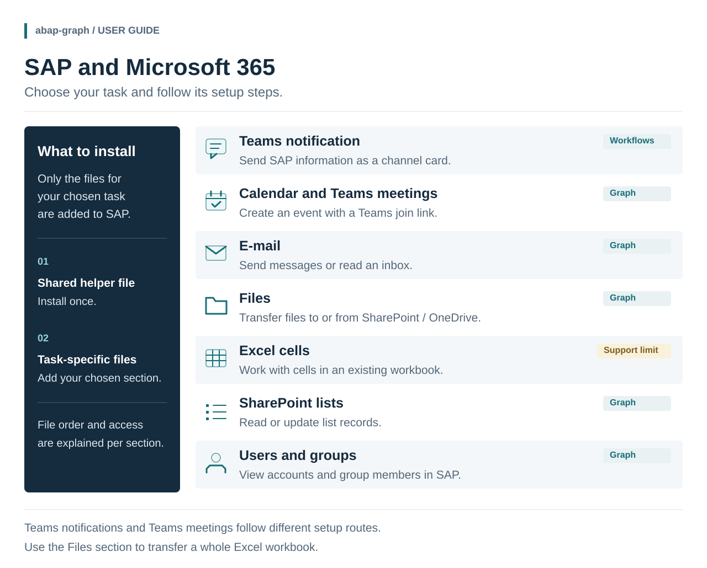
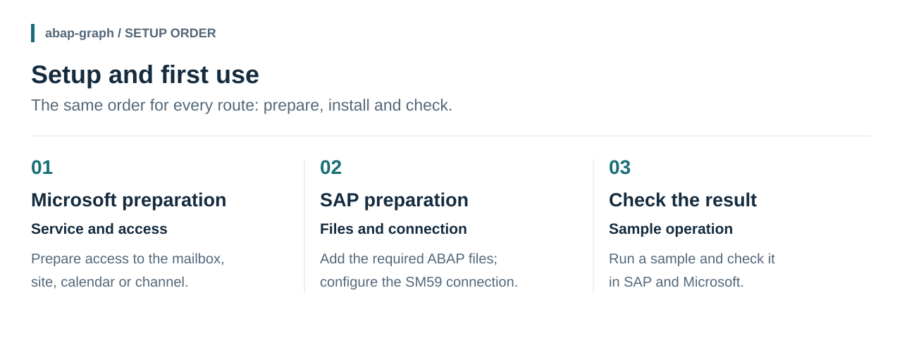

# SAP and Microsoft 365: setup and usage guide

[Project](README.md) · [Source files](src) · **English** | [Türkçe](WALKTHROUGH.tr.md)

**abap-graph** brings together ABAP files and example programs for accessing Microsoft 365 from SAP. Mail, file transfers, calendars, Teams notifications and Entra ID user checks can be used as separate sections.

This guide starts with the task you want to complete, then explains the preparation and first-use steps. The source files are in the [src folder](src); screenshots show the test environment. **Install only the section you need.** For example, sending a Teams channel message does not require the Mail or Excel sections.

## Overview

**Microsoft Graph** is the interface that lets programs access Microsoft 365 services such as mail, files and calendars with the appropriate permissions. **abap-graph** provides the ABAP files for using that connection from SAP. You do not install Microsoft Graph on your computer. [Microsoft's explanation](https://learn.microsoft.com/en-us/graph/overview)

A shared helper file handles connections and data exchange. Add it to SAP once, then add the files for your chosen task. Teams **channel notifications** use a Workflow connection created in Teams.

## 1. What would you like to do?

Each section covers its own preparation, required files and first trial. Choose your route from the table below.

| Your task | Guide |
| --- | --- |
| Send a notification card from SAP to a Teams channel | [Teams notification →](docs/guides/teams.md) |
| Create a meeting with a Teams join link; read a calendar | [Calendar and Teams meeting →](docs/guides/calendar.md) |
| Send e-mail from a mailbox or read incoming messages | [E-mail →](docs/guides/mail.md) |
| Upload or download SharePoint / OneDrive files | [Files →](docs/guides/files.md) |
| Read or change cells in an existing Excel workbook | [Excel →](docs/guides/excel.md) — read the support note first |
| Read or update records in a SharePoint list | [Lists →](docs/guides/lists.md) |
| View Microsoft users and group members in SAP | [Users and groups →](docs/guides/users.md) |
| Compare SAP accounts, roles and user details with Entra ID | [Three user checks →](docs/guides/users.md#4-compare-with-sap) |

**Two important distinctions:** Teams notifications and Teams meetings follow different routes. **Files** is sufficient for transferring a whole `.xlsx` file; choose **Excel** to work with its cells.

**For user checks:** choose [Active Directory or Entra ID](docs/guides/users.md#choose-the-directory) before installing. On-premises Active Directory uses the separate `abap-ldap-ad` tool; cloud Entra ID uses this project's Users module. You do not need both tools. The Graph comparisons only report differences.

## 2. The three parts of setup

| Stage | What to do | Authorization needed |
| --- | --- | --- |
| **Microsoft preparation** | Prepare the mailbox, site, calendar or channel and its access permissions | Relevant Microsoft 365 administration permissions |
| **SAP preparation** | Create the selected files in SE38 and configure connections in SM59 | SAP development and connection-configuration authorizations |
| **Result check** | Run a sample; check the result in SAP and Microsoft | Program execution and access to the relevant service |

One person can handle all of these tasks. You do not need to be a developer to understand the guide; if you lack installation permissions, share your chosen route with the relevant administrator. **Trying the supplied screens requires no coding.** Connecting them automatically to a business process requires ABAP development.

## 3. Shared file and section dependencies

What you install depends on your chosen task. The file relationships are:

- **Every route:** install the shared helper `ZCHE_GRAPH_CORE` once.
- **Graph routes:** reuse the same Microsoft application registration and two SAP connections. Grant any additional access required by a new function separately.
- **Teams notifications only:** no Graph application registration, two Graph destinations or `ZCHE_GRAPH_CHECK`; this route uses its own channel connection.
- **Excel:** also needs the Files **library**. The Files and Mail screens are not required.
- **Supplied Files screen:** also needs the Mail **library** for PDF conversion. This does not require mail permission or the Mail screen.

File order and program types are listed in the [SAP file installation guide](docs/guides/install.md). Your chosen route links there when needed.

## How to read the screenshots

The guide uses real A4H/001 and Microsoft 365 test screens. `Cheditte`, `SAP Test`, mailbox addresses and dates are **examples**; use your own environment's values. Program screens open in Turkish or English according to the SAP session language. Some Microsoft screens are also in Turkish; the English captions explain the relevant fields without altering the original evidence.

The images combine earlier trials with new captures from 5 November 2026 in A4H/001 with 0.7.4 installed; some labels vary by version. Captions distinguish field-entry examples from executed results. ECC 6.0 runtime compatibility and a least-privilege configuration have not yet been verified. Current scope: [What has been verified?](VALIDATION.md#what-has-been-verified)

The 0.8.0 user checks were tried on 6–7 November; the user guide explains them with an illustration. Its older SAP screenshots show user lookup, not the new comparison options. See [the recorded scope and telephone-test gap](docs/guides/users.md#5-what-was-tried).

Start by [choosing your route](#1-what-would-you-like-to-do), then try it in a development or test system.
