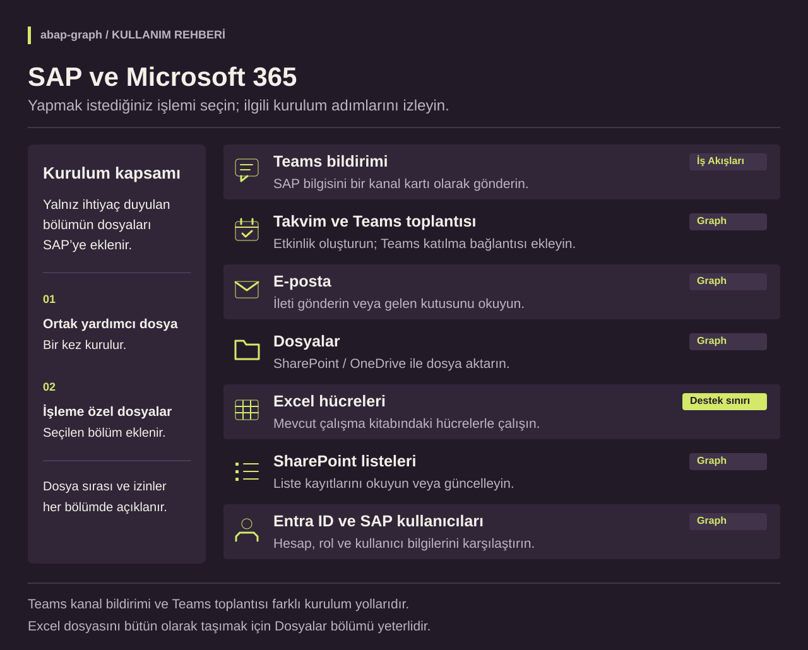
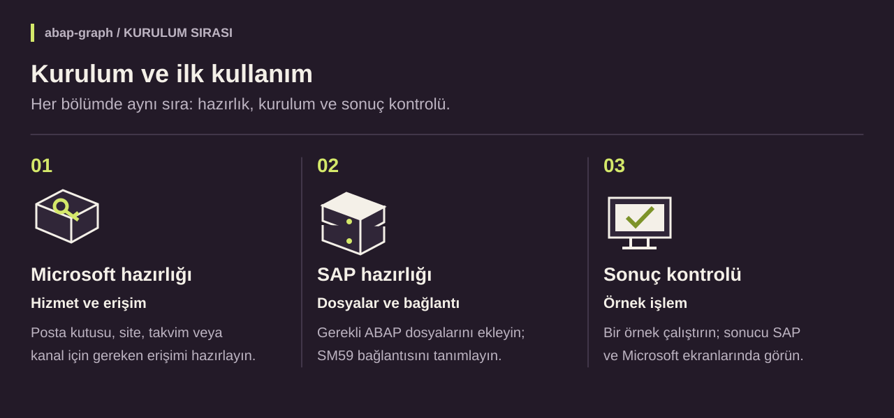

# SAP ve Microsoft 365: kurulum ve kullanım rehberi

[Proje](README.tr.md) · [Kaynak dosyalar](src)

**abap-graph**, SAP’den Microsoft 365 hizmetlerine erişmek için hazırlanmış ABAP dosyalarını ve örnek programları bir araya getirir. E-posta, dosya aktarımı, takvim ve Teams bildirimi gibi işlemler ayrı bölümler halinde kullanılabilir.

Bu rehber, yapmak istediğiniz işlemden başlayarak gerekli hazırlıkları ve ilk kullanım adımlarını açıklar. Kaynak dosyalar [src klasöründedir](src); ekran görüntüleri test ortamındaki uygulamayı gösterir. **Yalnız ihtiyacınız olan bölümü kurabilirsiniz.** Örneğin Teams kanalına mesaj göndermek için e-posta veya Excel bölümünü kurmanız gerekmez.

## Genel bakış

**Microsoft Graph**, programların Microsoft 365’teki posta, dosya ve takvim gibi hizmetlere izinli olarak ulaşmasını sağlayan arayüzdür. **abap-graph** ise bu bağlantıyı SAP’den kullanabilmeniz için hazırlanmış ABAP dosyalarıdır. Microsoft Graph’ı bilgisayarınıza kurmazsınız. [Microsoft’un açıklaması](https://learn.microsoft.com/en-us/graph/overview)

Bağlantı ve veri alışverişi için ortak bir yardımcı dosya kullanılır. SAP’ye bu dosyayı bir kez, ardından seçtiğiniz işlemin dosyalarını eklersiniz. Teams **kanal bildirimi**, Teams’te oluşturulan bir İş Akışı bağlantısı üzerinden gönderilir.

## 1. Ne yapmak istiyorsunuz?

Her bölüm kendi hazırlıklarını, gerekli dosyaları ve ilk denemeyi içerir. Aşağıdaki tablodan ihtiyacınıza uygun bölüme geçebilirsiniz.

| Yapmak istediğiniz işlem | İlgili rehber |
| --- | --- |
| SAP’den Teams kanalına bir bildirim kartı göndermek | [Teams bildirimi →](docs/guides/teams.tr.md) |
| Teams katılma bağlantısı olan toplantı oluşturmak; takvimi okumak | [Takvim ve Teams toplantısı →](docs/guides/calendar.tr.md) |
| Bir posta kutusundan e-posta göndermek veya gelenleri okumak | [E-posta →](docs/guides/mail.tr.md) |
| SharePoint / OneDrive’a dosya koymak veya oradan dosya almak | [Dosyalar →](docs/guides/files.tr.md) |
| Var olan Excel dosyasının hücrelerini okumak veya değiştirmek | [Excel →](docs/guides/excel.tr.md) — önce destek notunu okuyun |
| SharePoint listesindeki kayıtları okumak veya güncellemek | [Listeler →](docs/guides/lists.tr.md) |
| Microsoft kullanıcılarını ve grup üyelerini SAP’de görmek | [Kullanıcılar ve gruplar →](docs/guides/users.tr.md) |

**İki önemli ayrım:** Teams bildirimi ile Teams toplantısı farklı yollardır. Bir `.xlsx` dosyasını olduğu gibi taşımak için **Dosyalar** yeterlidir; içindeki hücrelerle çalışmak için **Excel** yolunu seçin.

## 2. Kurulumun üç parçası

| Aşama | Yapılacak işlem | Gerekli yetki |
| --- | --- | --- |
| **Microsoft hazırlığı** | Posta kutusu, site, takvim veya kanalı ve erişim izinlerini hazırlamak | İlgili Microsoft 365 yönetim yetkileri |
| **SAP hazırlığı** | Seçilen dosyaları SE38’de oluşturmak ve bağlantıları SM59’da tanımlamak | SAP geliştirme ve bağlantı ayarı yetkileri |
| **Sonuç kontrolü** | Örnek işlemi çalıştırmak; sonucu SAP ve Microsoft tarafında kontrol etmek | Programı çalıştırma ve ilgili hizmete erişim yetkileri |

Bu görevlerin hepsini aynı kişi yapabilir. Rehberi anlamak için yazılımcı olmanız gerekmez; kurulum yetkiniz yoksa seçtiğiniz yolu ilgili yöneticiyle paylaşın. **Hazır ekranlardan denemek için kod yazılmaz.** Bir iş sürecine otomatik olarak bağlamak için ABAP geliştirmesi gerekir.

## 3. Ortak dosya ve bölüm bağımlılıkları

Kurulum kapsamı seçtiğiniz işleme göre belirlenir. Dosyalar arasındaki ilişkiler şöyledir:

- **Her yol:** `ZCHE_GRAPH_CORE` adlı ortak yardımcı dosya bir kez kurulur.
- **Graph kullanan yollar:** aynı Microsoft uygulama kaydı ve iki SAP bağlantısı tekrar kullanılabilir. Yeni işlev için gereken erişim ayrıca tanımlanır.
- **Yalnız Teams bildirimi:** Graph uygulama kaydı, iki Graph bağlantısı ve `ZCHE_GRAPH_CHECK` gerekmez; kendi kanal bağlantısı kullanılır.
- **Excel:** ek olarak Dosyalar **kütüphanesini** ister. Dosyalar ve E-posta ekranlarını kurmanız gerekmez.
- **Hazır Dosyalar ekranı:** PDF dönüşümü için E-posta **kütüphanesini** de ister. Bu, e-posta izni istemek veya E-posta ekranını kurmak anlamına gelmez.

Dosya sırası ve türleri [SAP’ye dosya ekleme rehberinde](docs/guides/install.tr.md) listelenmiştir. Seçtiğiniz yol sizi gereken yerde bu sayfaya yönlendirir.

## Ekran görüntülerini nasıl okumalı?

Rehberde gerçek A4H/001 ve Microsoft 365 test ekranları kullanılmıştır. `Cheditte`, `SAP Test`, posta adresleri ve tarihler **örnek değerlerdir**; kendi ortamınızın bilgilerini kullanın. Program ekranları SAP oturum diline göre Türkçe veya İngilizce açılır. Gerektiğinde alan adları iki dilde belirtilmiştir.

Ekranlar önceki denemeleri ve 5 Kasım 2026’da 0.7.4 kurulu A4H/001 oturumunda alınan yeni görüntüleri birlikte içerir; bazı etiketler sürüme göre değişebilir. Alan doldurma örnekleri ile çalıştırılmış işlemlerin sonuçları görsel altında ayrı açıklanmıştır. ECC 6.0 üzerinde çalışma ve en az yetkili kurulum henüz doğrulanmış değildir. Güncel kapsam: [Neler doğrulandı?](VALIDATION.tr.md#neler-doğrulandı)

Başlamak için [işleminize uygun bölümü seçin](#1-ne-yapmak-istiyorsunuz) ve ilk denemeyi geliştirme veya test sisteminizde uygulayın.
