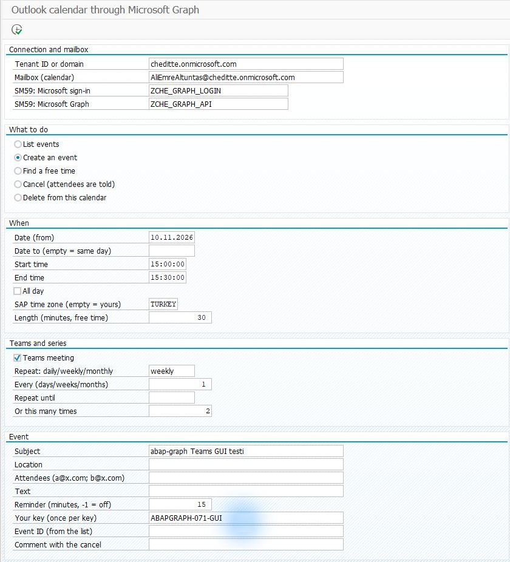
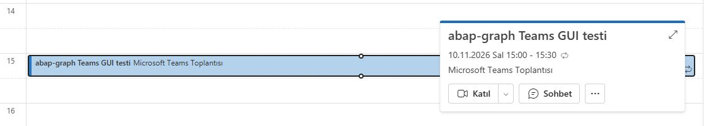
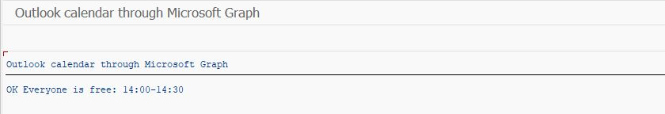

# Adding calendar events and Teams meetings from SAP

[Main guide](../../WALKTHROUGH.md) · For a channel card: [Teams notification](teams.md) · **English** | [Türkçe](calendar.tr.md)

The Calendar section creates and reads Outlook events from SAP. Selecting a Teams meeting adds a **Join** link to the event. Start with a test meeting without attendees and check the result in Outlook.

Setup order: [Graph connection](connection.md) → calendar access → Calendar files → test event.

## 1. Which calendar will you use?

Your Microsoft administrator prepares calendar access to the chosen mailbox (`Calendars.ReadWrite`, restricted to the required mailboxes). **For a Teams meeting, the organizer needs a licensed account that can create Teams meetings.** Do not assume every shared mailbox can do this.

## 2. Add the files

[SE38 steps](install.md): if the shared `ZCHE_GRAPH_CORE` already exists, do not create it again. Add the `ZCHE_GRAPH_CALENDAR_LIB` include, then the `ZCHE_GRAPH_CALENDAR` program. The Teams channel module is not required.

## 3. Create the first meeting

**SE38 → ZCHE_GRAPH_CALENDAR → F8**. Use your own Tenant and SM59 values from the [connection preparation](connection.md).

| Field | First trial |
| --- | --- |
| Mailbox | The authorized account whose calendar will be used |
| What to do | **Create an event** |
| Date, Start time, End time | A future date of your choice and a 30-minute interval |
| SAP time zone | `TURKEY` as defined in your system for Turkish time; use your own SAP time zone for another region |
| Teams meeting | Selected if you want a Teams join link |
| Repeat | Empty for the first trial; for example `weekly` for a recurring meeting |
| Subject | `SAP meeting test` |
| Attendees | Empty for the first trial; filling this sends real invitations |
| Your key | A value unique to this trial, such as `MEETING-TEST-01` |

*The 0.7.2 input example uses two weekly occurrences. You can leave recurrence fields empty for your first trial; use your own date and address.*

**F8 creates the event.** A successful result shows the event ID and, if Teams was selected, the join link.

## 4. See the result in Outlook

Open that account's Outlook calendar on your chosen date. Select the event to see its **Join** button.

*Actual event shown in Outlook during the 0.7.2 test. Check both applications' time zones when comparing SAP and Outlook times.*

The trial is complete when your calendar shows the correct time and join link. Use **List events** in SAP to read the same period. To search for free time, select **Find a free time** and enter attendee addresses, the date/time window and the duration in minutes.

Additional example: free-time search result

*The 30-minute interval found in the 0.7.2 test. This screen reports an available time for the selected people; it does not create a meeting.*

When deleting a test event, use only the ID of an event you created. Deleting a meeting from the organizer's calendar may send cancellation notices to attendees. [Recurrence, attendees and technical usage](../../TECHNICAL.md#outlook-calendar)
