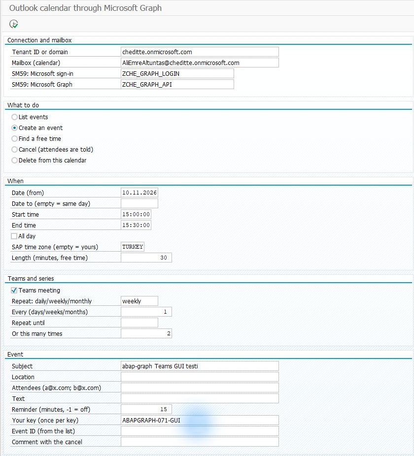
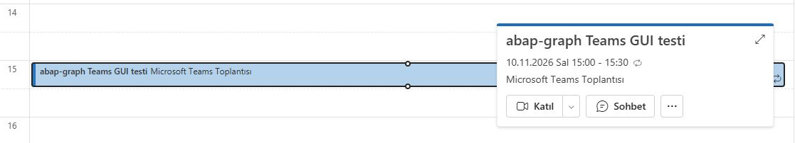
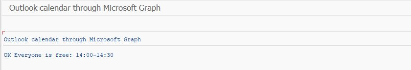

# SAP’den takvime etkinlik ve Teams toplantısı eklemek

[Ana rehber](../../WALKTHROUGH.tr.md) · Kanal kartı için: [Teams bildirimi](teams.tr.md) · [English](calendar.md) | **Türkçe**

Takvim bölümü, SAP’den Outlook etkinliği oluşturmak ve okumak için kullanılır. Teams toplantısı seçildiğinde etkinliğe **Katıl** bağlantısı eklenir. İlk kullanımda katılımcısız bir test toplantısı oluşturun ve sonucu Outlook’ta kontrol edin.

Kurulum sırası: [Graph bağlantısı](connection.tr.md) → takvim erişimi → Takvim dosyaları → test etkinliği.

## 1. Hangi takvim kullanılacak?

Microsoft yöneticiniz kullanılacak posta kutusuna takvim erişimini hazırlar (`Calendars.ReadWrite`; posta kutusu kapsamıyla sınırlandırılmalıdır). **Teams toplantısı için düzenleyicinin Teams toplantısı oluşturabilen lisanslı hesabı gerekir.** Her paylaşılan posta kutusunun bunu yapabildiğini varsaymayın.

## 2. Dosyaları ekleyin

[SE38 adımları](install.tr.md): ortak `ZCHE_GRAPH_CORE` zaten varsa tekrar oluşturmayın. `ZCHE_GRAPH_CALENDAR_LIB` include’unu, ardından `ZCHE_GRAPH_CALENDAR` programını ekleyin. Teams kanal modülünü kurmanız gerekmez.

## 3. İlk toplantıyı oluşturun

**SE38 → ZCHE_GRAPH_CALENDAR → F8**. Tenant ve SM59 alanlarında [bağlantı hazırlığındaki](connection.tr.md) kendi değerlerinizi kullanın.

| Alan | İlk denemede |
| --- | --- |
| Mailbox / Posta kutusu | Takvimi kullanılacak, yetkilendirilmiş hesap |
| What to do / İşlem | **Create an event / Etkinlik oluştur** |
| Date, Start time, End time | Kendi seçeceğiniz gelecek tarih ve 30 dakikalık aralık |
| SAP time zone | Türkiye saati için sisteminizde tanımlı `TURKEY`; başka bölgedeyseniz kendi SAP saat diliminiz |
| Teams meeting | Teams katılma bağlantısı istiyorsanız işaretli |
| Repeat / Tekrar | İlk denemede boş; tekrar eden toplantı istiyorsanız örneğin `weekly` |
| Subject / Konu | `SAP toplantı denemesi` |
| Attendees / Katılımcılar | İlk denemede boş; doldurursanız gerçek davetler gider |
| Your key / Anahtarınız | Bu denemeye özel değer, örneğin `TOPLANTI-DENEME-01` |

*0.7.2 giriş örneği haftalık iki tekrar kullanıyor. İlk denemenizde tekrar alanlarını boş bırakabilirsiniz; görseldeki tarihi ve adresi kopyalamayın.*

**F8** etkinliği gerçekten oluşturur. Başarılı sonuçta etkinlik kimliği; Teams seçiliyse katılma bağlantısı görünür.

## 4. Outlook’ta sonucu görün

İşlem yapılan hesabın Outlook takvimini, seçtiğiniz tarihte açın. Etkinliği seçtiğinizde **Katıl** düğmesini görmelisiniz.

*0.7.2 denemesinde Outlook’ta görülen gerçek etkinlik. SAP ve Outlook saatlerini karşılaştırırken iki uygulamanın saat dilimini de kontrol edin.*

Toplantı kendi takviminizde doğru saat ve katılma bağlantısıyla görünüyorsa deneme tamamdır. SAP’de **List events / Etkinlikleri listele** ile aynı dönemi okuyabilirsiniz. Boş zaman aramak için **Find a free time**, katılımcı adresleri, tarih aralığı ve dakika olarak süre girilir.

Ek örnek: uygun saat aramasının sonucu

*0.7.2 denemesinde bulunan 30 dakikalık aralık. Bu ekran toplantı oluşturmaz; aranan kişiler için uygun zamanı bildirir.*

Deneme etkinliğini silerken yalnız kendi oluşturduğunuz etkinliğin ID’sini kullanın. Düzenleyenin takviminden silinen toplantı katılımcılara iptal bildirimi gönderebilir. [Tekrar, katılımcılar ve teknik kullanım](../../TECHNICAL.tr.md#outlook-takvimi)
