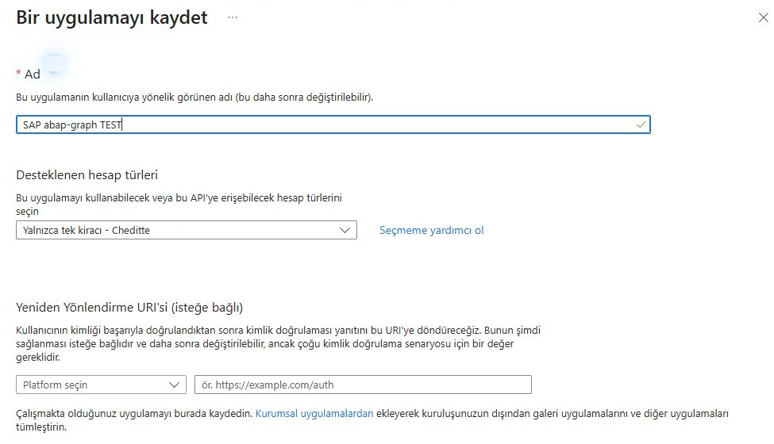
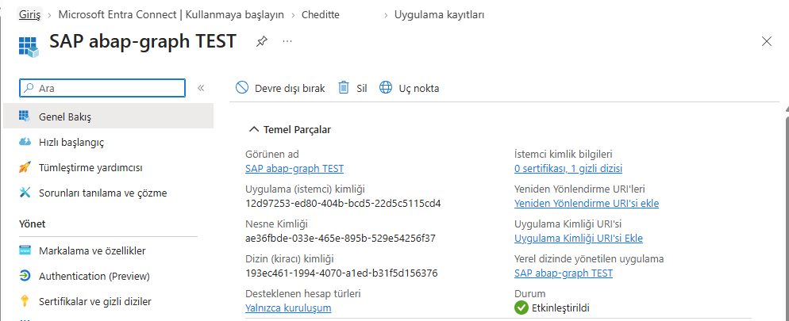
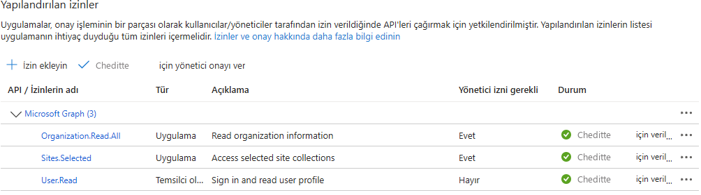
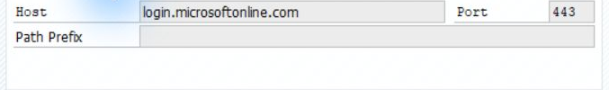
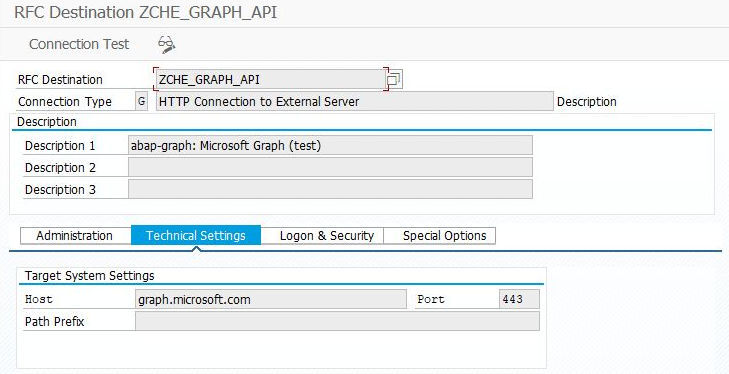
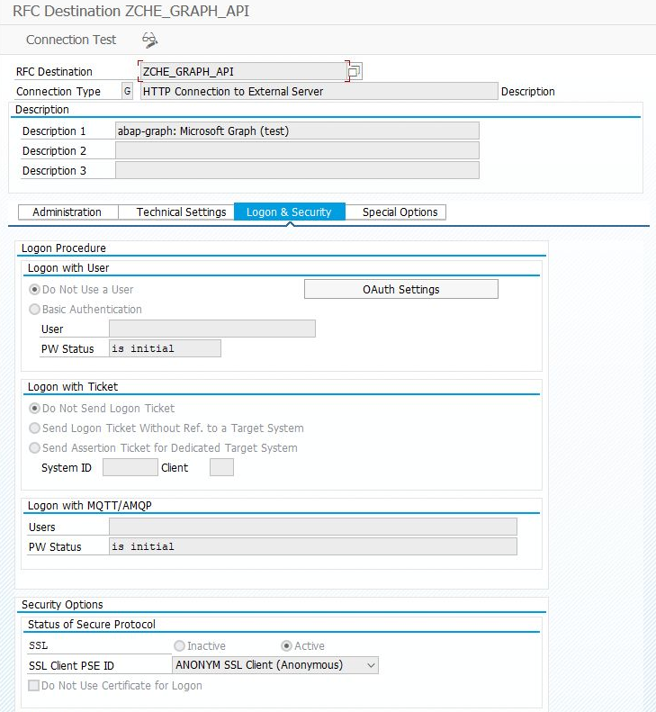
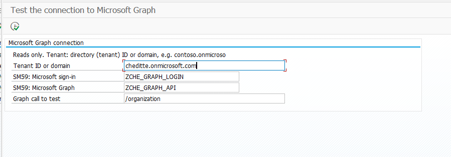

# Setting up the first connection between SAP and Microsoft

[Main guide](../../WALKTHROUGH.md) · **English** | [Türkçe](connection.tr.md)

This page explains the shared connection preparation for the Microsoft Graph routes. The same connection can be reused for mail, files and calendars. **For Teams channel notifications only, follow the [Teams guide](teams.md); that operation uses a separate connection.**

## 1. Register SAP on the Microsoft side

An application registration lets Microsoft identify requests from SAP. *Tenant* means your organization's Microsoft 365 environment; *Entra* is its identity and access management service.

Your Microsoft administrator opens **App registrations → New registration** in the [Entra admin center](https://entra.microsoft.com):

*Registration form example. Choose a name for your environment, then complete the registration with the Register button at the bottom.*

1. Enter a descriptive name, such as `SAP abap-graph TEST`. Select accounts in your own organization only. Leave the redirect URI empty.
2. Note the two IDs on the registration's **Overview** page.
3. Under **Certificates & secrets → New client secret**, create an application password. Securely store the **Value**, which is shown only once, and record its expiry date.

| Information | Where it is used |
| --- | --- |
| **Application (client) ID / Client ID** | The **User** field of SAP's `ZCHE_GRAPH_LOGIN` destination |
| **Directory (tenant) ID / Tenant ID** | The **Tenant ID or domain** field in the SAP programs |
| **Client secret Value / Secret Value** | Only the **Password** field of `ZCHE_GRAPH_LOGIN` |

**Secret ID and Secret Value are different.** Do not put the password in a program, variant, chat or screenshot.

*Example registration. Use your own application's IDs rather than copying those shown. The organization name was changed to Cheditte for presentation.*

## 2. Grant access for the selected task

Prepare the access listed in your module guide with your Microsoft administrator. Where **API permissions** are used, select **Application** permissions and grant admin consent. Being an administrator yourself does not automatically grant access to the SAP application.

- **Mail / calendar:** restrict access to the mailboxes you will use. [Authorization details](../../TECHNICAL.md#what-the-e-mail-module-needs-in-addition)
- **SharePoint:** after consenting to `Sites.Selected`, grant access to the chosen site separately. Adding the permission name alone is not enough. [Microsoft's explanation](https://learn.microsoft.com/en-us/graph/permissions-selected-overview)
- **Excel:** read the [cell-operation support limitation](excel.md#before-you-start); do not add broad admin permissions just to make it run.

*Consent example for the SharePoint route. The `Sites.Selected` row is approved; the site still needs a separate access grant. Other rows belong to this test application and are not required for every installation.*

## 3. Save two connections in SAP

**SM59** is where SAP stores connections to external systems. Your Basis / SAP administrator creates two **type G — HTTP Connection to External Server** destinations:

| Field | Microsoft sign-in | Microsoft Graph calls |
| --- | --- | --- |
| RFC Destination | `ZCHE_GRAPH_LOGIN` | `ZCHE_GRAPH_API` |
| Target Host | `login.microsoftonline.com` | `graph.microsoft.com` |
| Service No. | `443` | `443` |
| Path Prefix | Empty | Empty |
| Logon & Security | **Basic Authentication**; User = your Client ID, Password = your Secret Value | **Do Not Use a User** |
| SSL | **Active**, suitable SSL Client PSE; `ANONYM` in this example | **Active**, suitable SSL Client PSE |

These two Microsoft host names are the same for everyone. The Client ID and password belong to your application. If you choose different destination names, use those names in the programs too.

*Technical settings example. The password screen is not shown.*

*Second destination: the Graph API address. Enter only `graph.microsoft.com` in Host, without `https://`.*

*The Graph destination has no user/password; the program supplies an access token when making the call. SSL is active with PSE `ANONYM` in A4H. Use the appropriate PSE prepared by your Basis team.*

The SAP application server needs HTTPS access to these hosts. For certificate errors, Basis checks the trust chain of the destination's SSL Client PSE in **STRUST**. SharePoint transfers also need access to your SharePoint host. [Network and certificate details](../../TECHNICAL.md#what-you-need)

## 4. Check that the connection works

Install the shared helper and `ZCHE_GRAPH_CHECK` as described in the [file installation guide](install.md). **SE38 → ZCHE_GRAPH_CHECK → F8**:

1. **Tenant ID or domain:** enter your Tenant ID or your `yourcompany.onmicrosoft.com` domain. This is not a password field.
2. Check the two SM59 names. Run with **F8**.
3. The program shows the destination checks, then Microsoft sign-in. **OK** in the sign-in section means the application credentials were accepted.

*Input screen. Enter your own tenant; the permission for the `/organization` call below is explained next.*

*Actual result from a 0.5.1 test. Do not copy the broad test permissions shown into your own setup.*

The default final call, `/organization`, needs `Organization.Read.All`. Without it, **sign-in may succeed while the final call returns 403**. That does not mean your selected module will fail: try your own module next. You do not need to add organization-read permission just to make this screen green. An HTTP 200 in SM59 alone does not verify application sign-in.

**Next — your selected section:** [Teams meeting](calendar.md) · [E-mail](mail.md) · [Files](files.md) · [Excel](excel.md) · [Lists](lists.md) · [Users](users.md)
