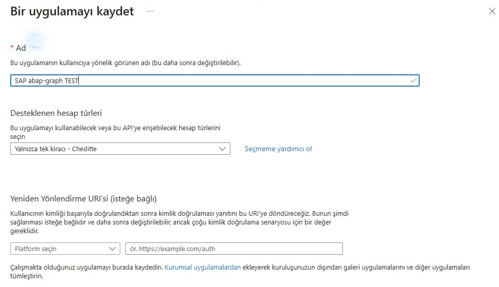
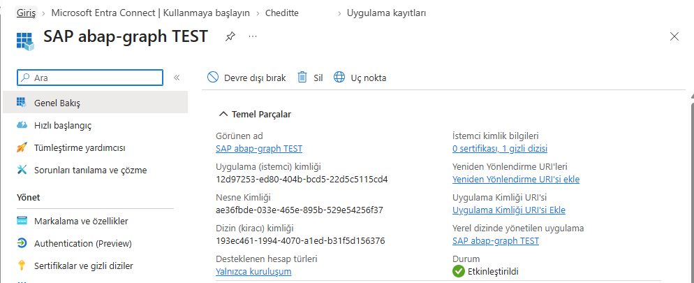
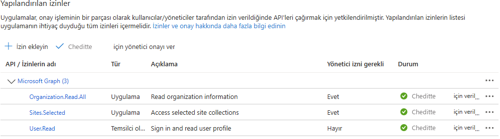
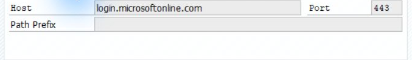
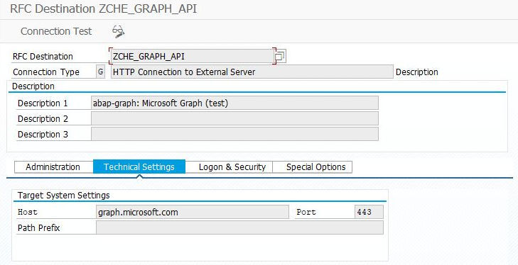
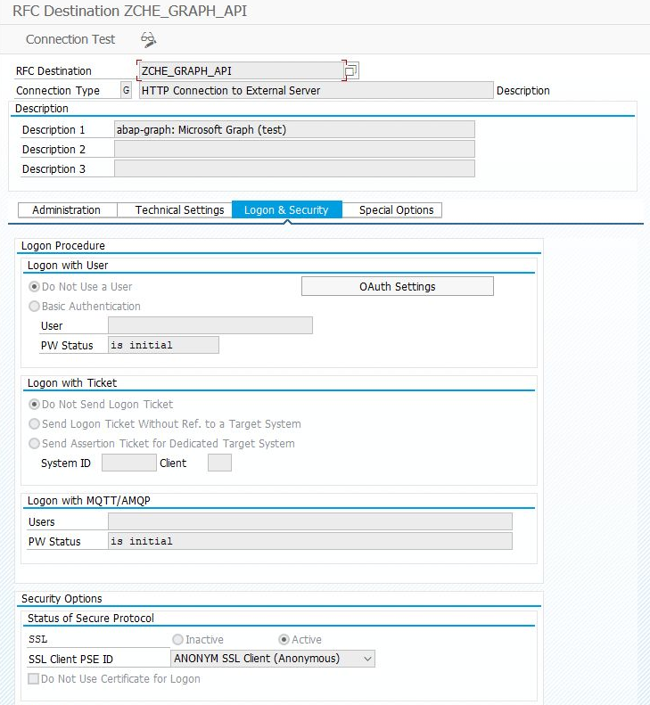
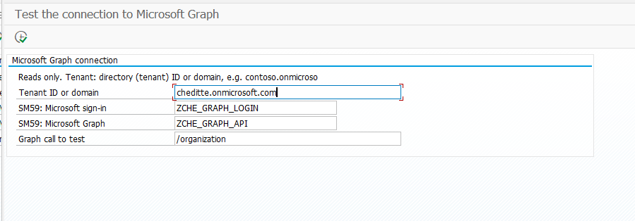

# SAP ile Microsoft arasında ilk bağlantıyı kurmak

[Ana rehber](../../WALKTHROUGH.tr.md) · [English](connection.md) | **Türkçe**

Bu sayfa, Microsoft Graph kullanan bölümlerin ortak bağlantı hazırlığını açıklar. Aynı bağlantı posta, dosya ve takvim gibi işlemlerde tekrar kullanılabilir. **Yalnız Teams kanal bildirimi için [Teams rehberini](teams.tr.md) izleyin; bu işlem ayrı bir bağlantı kullanır.**

## 1. Microsoft tarafında SAP’yi tanıtın

Uygulama kaydı, SAP’den gelen isteklerin Microsoft tarafından tanınmasını sağlar. Ekranlarda geçen *Tenant*, kuruluşunuzun Microsoft 365 ortamını; *Entra* ise kimlik ve erişim yönetimini ifade eder.

Microsoft yöneticiniz [Entra yönetim merkezinde](https://entra.microsoft.com) **Uygulama kayıtları → Yeni kayıt** açar:

*Kayıt formu örneği. Uygulama adını kendi ortamınıza göre belirleyin; aşağıdaki Kaydol düğmesiyle kaydı tamamlayın.*

1. Açıklayıcı bir ad girin, örneğin `SAP abap-graph TEST`. Yalnız kendi kuruluşunuzdaki hesapları seçin. Yönlendirme adresini boş bırakın.
2. Kaydın **Genel Bakış** sayfasındaki iki kimliği not edin.
3. **Sertifikalar ve gizli diziler → Yeni istemci gizli dizisi** ile uygulama için bir parola oluşturun. Bir kez gösterilen **Değer / Value** bilgisini güvenli saklayın; sona erme tarihini kaydedin.

| Bilgi | Nerede kullanılacak? |
| --- | --- |
| **Uygulama (istemci) kimliği / Client ID** | SAP’de `ZCHE_GRAPH_LOGIN` bağlantısının **User** alanı |
| **Dizin (kiracı) kimliği / Tenant ID** | SAP programlarının **Tenant ID or domain** alanı |
| **Gizli dizi Değeri / Secret Value** | Yalnız `ZCHE_GRAPH_LOGIN` bağlantısının **Password** alanı |

**Secret ID ile Secret Value aynı şey değildir.** Parolayı programa, varyanta, sohbete veya ekran görüntüsüne yazmayın.

*Örnek uygulama kaydı. Görseldeki kimlikleri kopyalamayın; kendi uygulamanızın değerlerini kullanın. Kuruluş adı sunum için Cheditte olarak düzenlenmiştir.*

## 2. Yalnız seçilen işe erişim verin

Seçtiğiniz modül sayfasındaki erişim ihtiyacını Microsoft yöneticinizle hazırlayın. **API izinleri** kullanılıyorsa türü **Uygulama / Application** olmalı ve yönetici onayı verilmelidir. Kendi Microsoft hesabınızın yönetici olması, SAP uygulamasına otomatik erişim sağlamaz.

- **Posta / takvim:** erişim, kullanılacak posta kutularıyla sınırlandırılmalıdır. [Yetkilendirme ayrıntıları](../../TECHNICAL.tr.md#e-posta-modülünün-ek-gereksinimleri)
- **SharePoint:** `Sites.Selected` onayından sonra kullanılacak siteye ayrıca erişim atanır. Yalnız izin adını eklemek yeterli değildir. [Microsoft’un açıklaması](https://learn.microsoft.com/en-us/graph/permissions-selected-overview)
- **Excel:** hücre işlemleri için [destek sınırını](excel.tr.md#başlamadan-önce) okuyun; çalıştırmak amacıyla geniş yönetici izinleri eklemeyin.

*SharePoint yolu için izin onayı örneği. `Sites.Selected` satırı onaylı; erişilecek siteye ayrıca yetki atanması gerekir. Diğer satırlar bu test uygulamasına aittir, her kurulumda gerekli değildir.*

## 3. SAP’de iki bağlantıyı kaydedin

**SM59**, SAP’nin dış sistemlere bağlantı adreslerini tuttuğu ekrandır. Basis / SAP yöneticiniz burada iki **G tipi — HTTP Connection to External Server** hedefi oluşturur:

| Alan | Microsoft girişi | Microsoft Graph çağrıları |
| --- | --- | --- |
| RFC Destination | `ZCHE_GRAPH_LOGIN` | `ZCHE_GRAPH_API` |
| Target Host | `login.microsoftonline.com` | `graph.microsoft.com` |
| Service No. | `443` | `443` |
| Path Prefix | Boş | Boş |
| Logon & Security | **Basic Authentication**; User = kendi Client ID’niz, Password = kendi Secret Value’nuz | **Do Not Use a User** |
| SSL | **Active**, uygun SSL Client PSE; örnekte `ANONYM` | **Active**, uygun SSL Client PSE |

Bu iki Microsoft host adı herkes için aynıdır. Client ID ve parola sizin uygulamanıza aittir. Bağlantı adlarını değiştirirseniz programlarda da aynı adları kullanın.

*Teknik ayarlar örneği. Parola ekranı gösterilmemiştir.*

*İkinci hedef: Graph çağrılarının adresi. Host alanına yalnız `graph.microsoft.com` yazın; `https://` eklemeyin.*

*Graph hedefinde kullanıcı/parola tanımlanmaz; program erişim belirtecini çağrı sırasında kullanır. A4H örneğinde SSL etkin ve PSE `ANONYM`. Kendi sisteminizde Basis ekibinin hazırladığı uygun PSE’yi seçin.*

SAP uygulama sunucusundan bu adreslere HTTPS erişimi olmalıdır. Sertifika hatası varsa Basis ekibi **STRUST** içinde bağlantının kullandığı SSL Client PSE’nin güven zincirini kontrol eder. SharePoint dosya aktarımında kendi SharePoint hostunuza erişim de gerekir. [Ağ ve sertifika ayrıntıları](../../TECHNICAL.tr.md#neler-gerekiyor)

## 4. Bağlantının çalıştığını görün

[Dosya kurulumundaki](install.tr.md) ortak yardımcı dosyayı ve `ZCHE_GRAPH_CHECK` ekranını ekleyin. **SE38 → ZCHE_GRAPH_CHECK → F8**:

1. **Tenant ID or domain:** kendi Tenant ID’nizi veya `sirketiniz.onmicrosoft.com` alan adınızı girin. Bu alan parola alanı değildir.
2. İki SM59 adını kontrol edin. **F8** ile çalıştırın.
3. Önce bağlantı tanımları, sonra Microsoft girişinin sonucu gösterilir. Giriş bölümündeki **OK**, uygulamanın kimlik bilgilerinin kabul edildiğini gösterir.

*Giriş ekranı. Tenant alanına kendi kuruluşunuzu girin; alttaki `/organization` çağrısının izin gereksinimi aşağıda açıklanmıştır.*

*0.5.1 denemesinden gerçek sonuç. İzin satırındaki geniş test izinlerini kendi kurulumunuza kopyalamayın.*

Varsayılan son çağrı `/organization`, `Organization.Read.All` ister. Bu izin yoksa **giriş başarılı olduğu halde son çağrı 403 dönebilir**. Bu, seçtiğiniz modülün de çalışmayacağı anlamına gelmez: sıradaki adımda kendi modülünüzü deneyin. Yalnız bu ekranı yeşile çevirmek için kuruluş bilgisi izni eklemek zorunda değilsiniz. SM59’daki HTTP 200 ise tek başına uygulama girişini doğrulamaz.

**Sonraki adım — ilgili bölüm:** [Teams toplantısı](calendar.tr.md) · [E-posta](mail.tr.md) · [Dosyalar](files.tr.md) · [Excel](excel.tr.md) · [Listeler](lists.tr.md) · [Kullanıcılar](users.tr.md)
