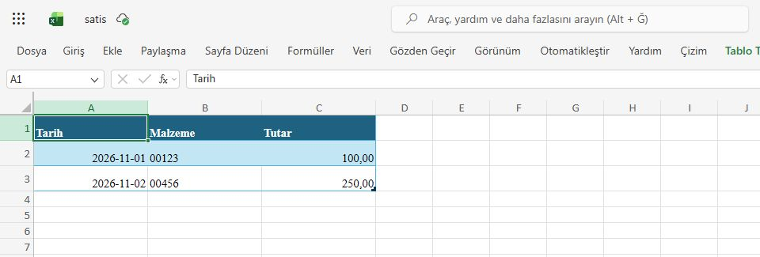
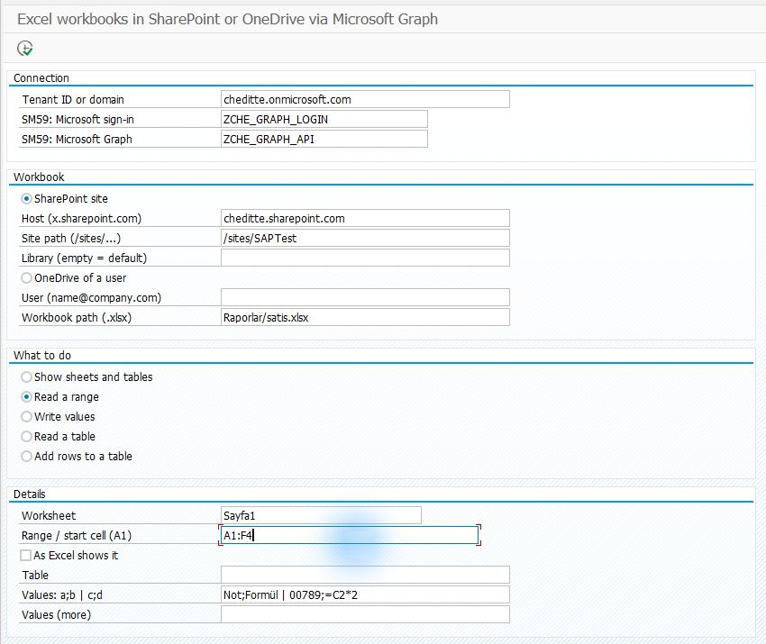
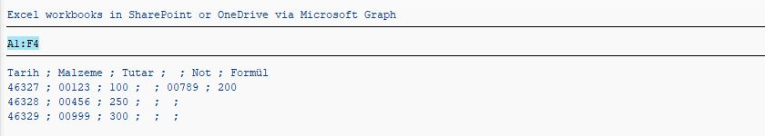
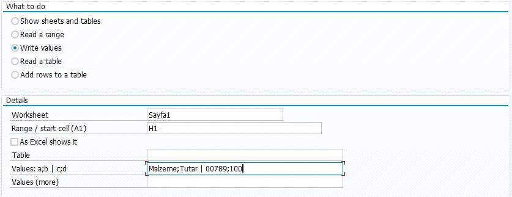
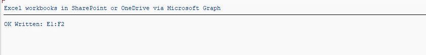

# Working with cells in an existing Excel workbook

[Main guide](../../WALKTHROUGH.md) · To transfer the whole file: [Files](files.md) · **English** | [Türkçe](excel.tr.md)

The Excel section reads and changes cells in an existing workbook stored in SharePoint or OneDrive. The steps below describe the test-environment workflow. Read the support limitation before setting it up.

## Before you start

**This route has a support limitation.** The project signs in with an application identity, without a user session. Microsoft does not list this sign-in type as supported for Workbook API operations such as reading cells. Operations worked in our test environment, but the application had broad site permission and was not verified with `Sites.Selected` alone. Treat this route as an **experimental option**; do not try to solve access problems by granting broad permissions. [Microsoft permission table](https://learn.microsoft.com/en-us/graph/api/range-get?view=graph-rest-1.0)

If you want to upload/download a whole `.xlsx` file, the [Files route](files.md) is not affected by this Workbook API limitation.

## 1. Prepare a sample workbook

Prepare the [Graph connection](connection.md) and access to the file's location. Upload a **test copy** to the SharePoint document library, for example `Raporlar/satis.xlsx`. Include a worksheet with a few filled cells. This screen does not create a new workbook from scratch.

*Preparation example: check that the file opens on the web and note the worksheet's name. The image shows the sample test data.*

## 2. Install only the required files

[SE38 order](install.md): `ZCHE_GRAPH_CORE` → `ZCHE_GRAPH_FILES_LIB` → `ZCHE_GRAPH_EXCEL_LIB` → `ZCHE_GRAPH_EXCEL`.

Excel uses the Files library to locate the workbook. **The Files screen and Mail library are not required.**

## 3. Read the first cells

**SE38 → ZCHE_GRAPH_EXCEL → F8**. Enter your Tenant and SM59 values; fill Host and Site path as described in the [Files route](files.md#3-list-the-folder-first).

| Field | First trial |
| --- | --- |
| Library | Empty if the file is in the default library |
| Workbook path | Your own path within the library, for example `Raporlar/satis.xlsx` |
| What to do | **Read a range** |
| Worksheet | The actual tab name shown at the bottom of Excel, for example `Sayfa1` |
| Range | `A1:B3`: the first three rows of columns A and B |
| As Excel shows it | Select to read dates/numbers in their displayed Excel format |

*The 0.5.1 read example uses A1:F4. The populated Values fields are not used by the read operation.*

After **F8**, compare the cells listed in SAP with the same cells in Excel. If access is denied, consider the support note above.

*Read result from the 0.5.1 test. The test workbook was edited after the preparation image, so extra columns appear here.*

## 4. Optionally write sample values

Choose empty cells in the test copy. Select **Write values**, start cell `H1`, and values `Malzeme;Tutar | 00789;100`. `;` separates cells and `|` separates rows. **F8 changes the actual file.** Open the workbook on the web and check both rows.

*Field-entry example in A4H/001 with 0.7.4 installed. No write was executed for this image; the result below is from a separate, earlier test.*

*The earlier test wrote E1:F2. Compare your own selected range with the result message and Excel.*

*A different range from the 0.5.1 test, showing `00789` preserved as text. This does not establish general Microsoft support for these cell operations.*

[Tables, formulas and technical usage](../../TECHNICAL.md#excel-workbooks)
