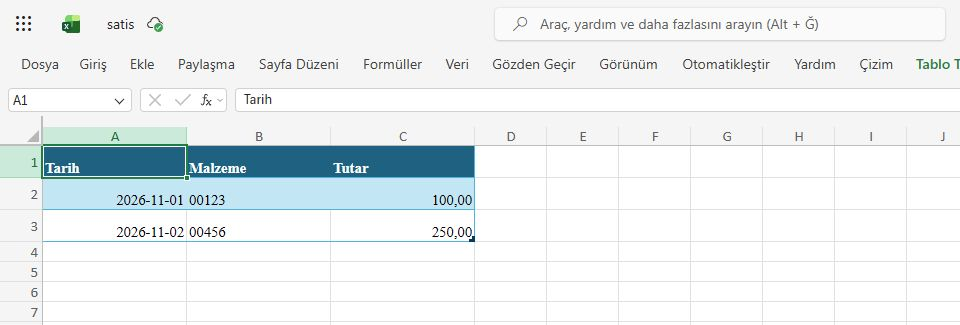
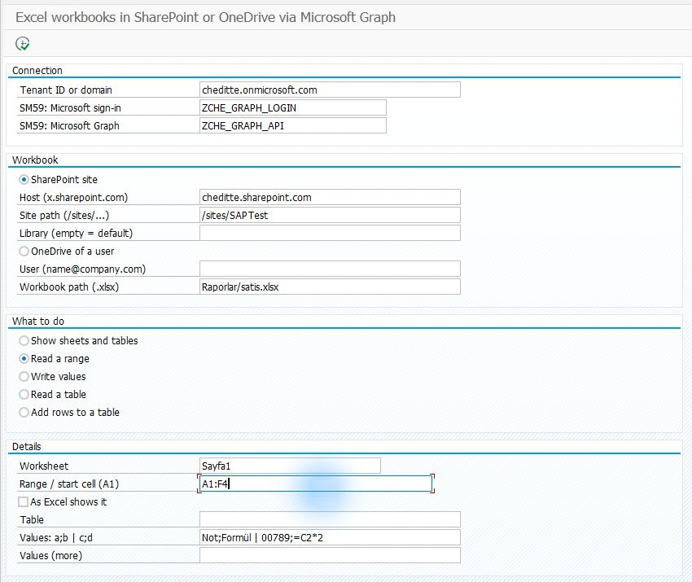
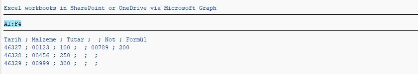
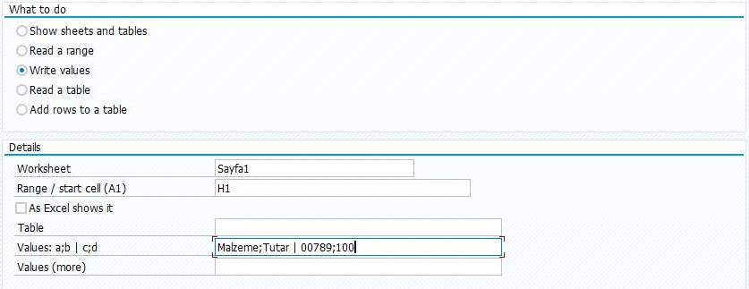
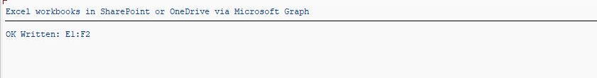

# Var olan bir Excel dosyasının hücreleriyle çalışmak

[Ana rehber](../../WALKTHROUGH.tr.md) · Dosyanın tamamını aktarmak için: [Dosyalar](files.tr.md)

Excel bölümü, SharePoint veya OneDrive’daki mevcut bir çalışma kitabının hücrelerini okumak ve değiştirmek için hazırlanmıştır. Aşağıdaki adımlar test ortamında yapılan uygulamayı açıklar. Kuruluma geçmeden önce destek sınırını inceleyin.

## Başlamadan önce

**Bu yolun bir destek sınırı var.** Proje, kullanıcı oturumu olmadan uygulama kimliğiyle bağlanır. Microsoft, Excel hücre okuma gibi Workbook API işlemlerinde bu giriş türünü destekleniyor olarak belirtmiyor. Test ortamımızdaki işlemler çalıştı; ancak uygulamada geniş bir site izni vardı ve yalnız `Sites.Selected` ile doğrulanmadı. Bu nedenle bu yolu bir **deneme seçeneği** olarak değerlendirin; geniş izin vererek sorunu çözmeye çalışmayın. [Microsoft izin tablosu](https://learn.microsoft.com/en-us/graph/api/range-get?view=graph-rest-1.0)

Amacınız hazır `.xlsx` dosyasını olduğu gibi yüklemek/indirmekse [Dosyalar yolunda](files.tr.md) bu Workbook API sınırlaması yoktur.

## 1. Bir örnek kitap hazırlayın

[Graph bağlantısını](connection.tr.md) ve dosyanın bulunduğu yere erişimi hazırlayın. SharePoint’in belge kitaplığına **deneme amaçlı bir kopya** yükleyin; örneğin `Raporlar/satis.xlsx`. Kitabın içinde bir çalışma sayfası ve birkaç dolu hücre bulunsun. Bu ekran sıfırdan yeni bir Excel kitabı oluşturmaz.

*Hazırlık örneği: dosyanın web’de açıldığını ve çalışma sayfasının adını kontrol edin. Testte kullanılan örnek veriler gösterilmiştir.*

## 2. Yalnız gerekli dosyaları kurun

[SE38 sırası](install.tr.md): `ZCHE_GRAPH_CORE` → `ZCHE_GRAPH_FILES_LIB` → `ZCHE_GRAPH_EXCEL_LIB` → `ZCHE_GRAPH_EXCEL`.

Excel, çalışma kitabını bulmak için Dosyalar kütüphanesini kullanır. **Dosyalar ekranı ve E-posta kütüphanesi gerekmez.**

## 3. İlk hücreleri okuyun

**SE38 → ZCHE_GRAPH_EXCEL → F8**. Tenant ve SM59 değerlerinizi girin; Host ve Site path alanları [Dosyalar yolundaki](files.tr.md#3-önce-klasörü-listeleyin) gibi doldurulur.

| Alan | İlk denemede |
| --- | --- |
| Library / Kitaplık | Dosya varsayılan kitaplıktaysa boş |
| Workbook path | Kitaplık içindeki kendi yolunuz; örneğin `Raporlar/satis.xlsx` |
| What to do | **Read a range / Aralık oku** |
| Worksheet / Çalışma sayfası | Excel’de altta görünen gerçek sekme adı; örneğin `Sayfa1` |
| Range / Aralık | `A1:B3`: A ve B sütunlarının ilk üç satırı |
| As Excel shows it | Tarih/sayıları Excel’de görünen biçimde okumak istiyorsanız işaretleyin |

*0.5.1 okuma örneği A1:F4 aralığını kullanıyor. Ekranda dolu görünen Values alanları okuma işleminde kullanılmaz.*

**F8** sonrası seçtiğiniz hücreleri SAP listesinde, Excel’deki aynı hücrelerle karşılaştırın. Erişim reddedilirse yukarıdaki destek notunu dikkate alın.

*0.5.1 denemesinin okuma sonucu. Test kitabı hazırlık ekranından sonra da düzenlendiği için burada ek sütunlar bulunuyor.*

## 4. İsterseniz örnek bir değer yazın

Deneme kopyasında boş hücreler seçin. **Write values / Değer yaz**, başlangıç hücresi `H1`, değerler `Malzeme;Tutar | 00789;100` olsun. `;` hücreleri, `|` satırları ayırır. **F8 gerçek dosyayı değiştirir.** Web’de kitabı açıp iki satırı kontrol edin.

*0.7.4 kurulu A4H/001 oturumunda alanların nasıl doldurulduğunu gösteren örnek. Bu görüntü için yazma işlemi çalıştırılmadı; alttaki sonuç ayrı, eski bir denemeye aittir.*

*Eski testte E1:F2 aralığı yazılmış. Siz kendi seçtiğiniz aralığı sonuç mesajı ve Excel üzerinde karşılaştırın.*

*0.5.1 testindeki farklı bir hücre aralığı; `00789` değerinin metin olarak korunduğunu gösterir. Hücre işlemlerinin Microsoft tarafından genel olarak desteklendiği anlamına gelmez.*

[Tablolar, formüller ve teknik kullanım](../../TECHNICAL.tr.md#excel-çalışma-kitapları)
