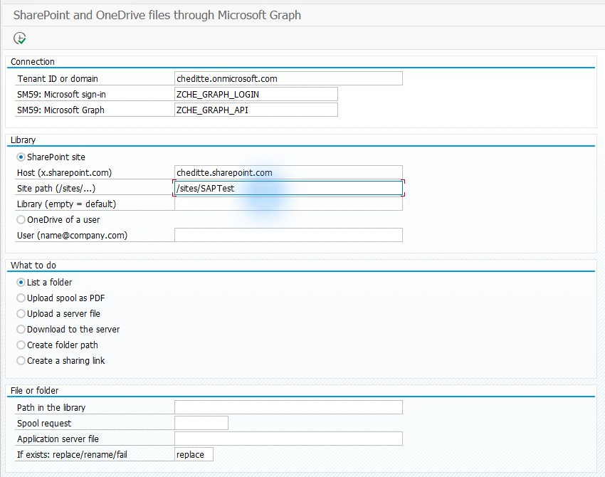
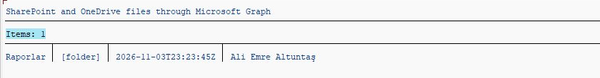
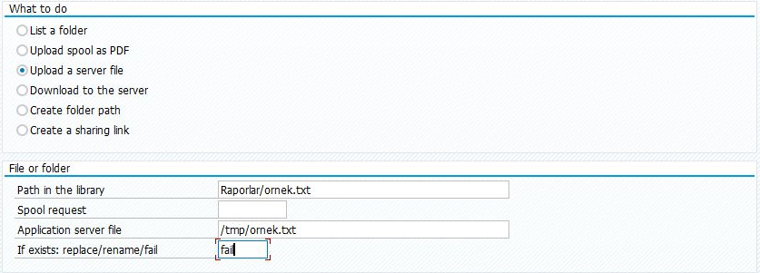
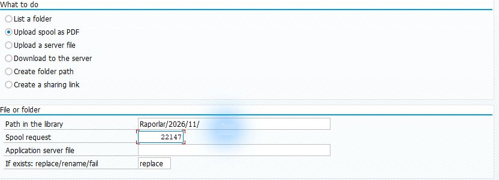
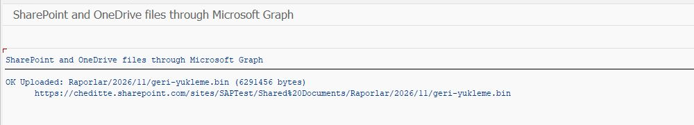
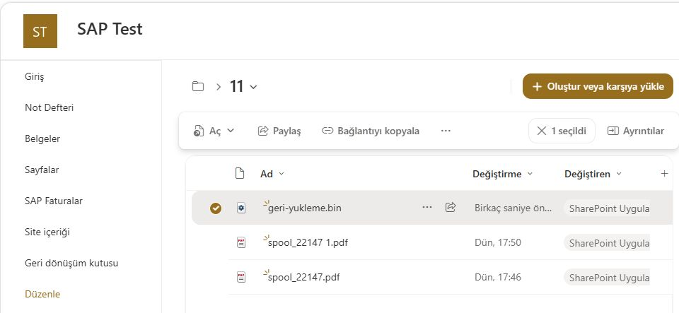

# Transferring files between SAP and SharePoint or OneDrive

[Main guide](../../WALKTHROUGH.md) · **English** | [Türkçe](files.tr.md)

The Files section lists SharePoint or OneDrive folders and transfers files to and from SAP. Start by listing a folder, then transfer a sample file. This section is also sufficient for uploading or downloading a **whole** Excel file.

## 1. Prepare the connection and location

Set up the [Graph connection](connection.md). For SharePoint, your Microsoft administrator grants `Sites.Selected` and **separate access to the selected site**. A user's OneDrive needs a different access scope; do not treat it as the same as a site grant. [Permission details](../../TECHNICAL.md#what-the-files-module-needs-in-addition)

Start with a test site and one sample file.

## 2. Install the supplied Files screen

[SE38 file order](install.md): `ZCHE_GRAPH_CORE` → `ZCHE_GRAPH_MAIL_LIB` → `ZCHE_GRAPH_FILES_LIB` → `ZCHE_GRAPH_FILES`.

The Mail library is used here only to convert spool output to PDF. **The Mail screen and mail permissions are not required.** Developers using only the Files library in their own ABAP code do not have this extra dependency.

## 3. List the folder first

**SE38 → ZCHE_GRAPH_FILES → F8**. Enter your Tenant and SM59 details. For a SharePoint site address such as `https://yourcompany.sharepoint.com/sites/Finance`:

| Field | What to enter |
| --- | --- |
| SharePoint site | Selected |
| Host | `yourcompany.sharepoint.com` from your own address, without `https://` |
| Site path | Your site's path, `/sites/Finance` in this example |
| Library | Leave empty for the first trial: the site's default document library |
| What to do | **List a folder** |
| Path in the library | Empty for the first trial: library root. For a subfolder, use its name, such as `Raporlar` |

*Test-environment addresses are examples. Do not paste the library name or full browser URL into Site path.*

After **F8**, expect folder/file names. Zero results are normal for an empty library; add a sample file on the web and list again.

*This test lists Raporlar at the library root. To see its contents, enter your folder name in Path.*

## 4. Transfer a file

- **Upload a server file:** enter the full source path on the application server and the destination path in the library. **This is not your computer's Downloads folder.** An authorized person needs to prepare the SAP server path.
- **Download to the server:** enter the source path in the library and the destination path on the SAP application server.
- **Upload spool as PDF:** enter an existing SAP spool number and a PDF destination path in the library. If the path ends in `/`, the program appends the spool's file name.

The upload screen may preselect **replace** for an existing file name. Use a new file name or select **fail** for your first trial so you do not overwrite an existing file.

*Field example in A4H/001 with 0.7.4 installed; no transfer was executed for this image. `Path in the library` is the destination; `Application server file` is the source on SAP's server. `/tmp/ornek.txt` is an example Linux path; enter the full path of an existing, readable file on your server.*

*Spool-to-PDF upload example. The spool's file name is appended to `Raporlar/2026/11/`. The spool number belongs to this test. The image has replace selected; use a new name or fail for your first trial.*

*A separate 0.5.1 transfer test uploaded a 6 MiB file. This result is from a different run than the PDF input example above.*

*Destination check. In your own environment, verify the file name, size and that the file opens.*

After the transfer message, open the file at its destination too. This confirms that the file arrived as well as that the connection worked. [Other operations and use in your own code](../../TECHNICAL.md#sharepoint-and-onedrive-files)
