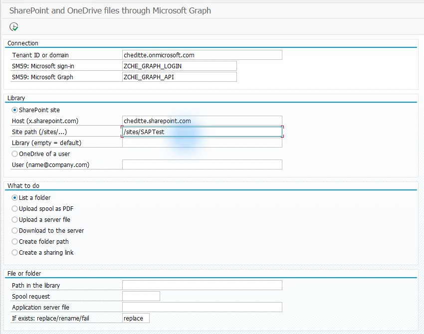
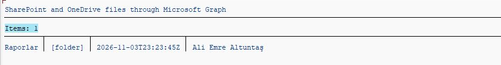
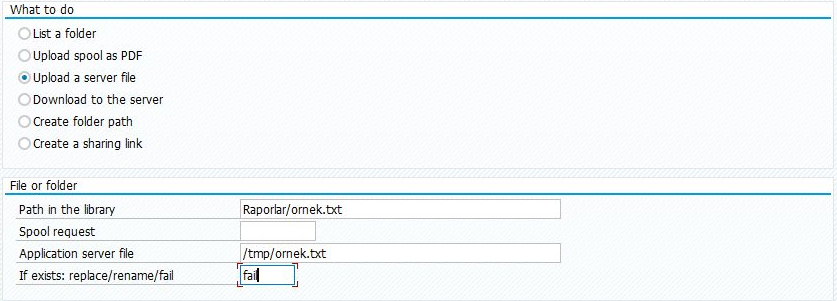
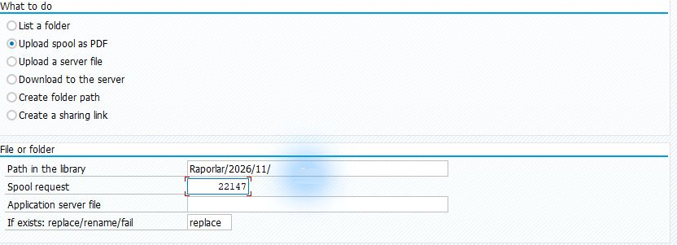
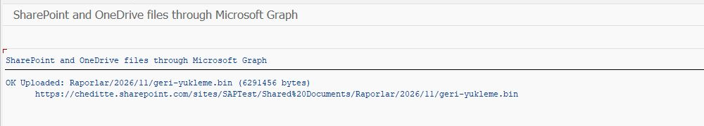
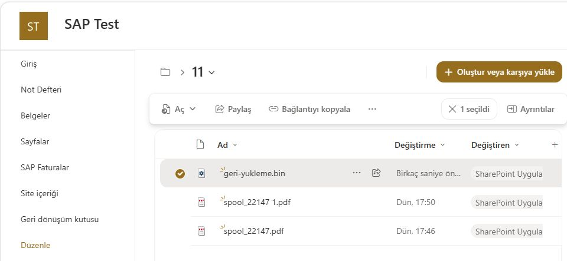

# SAP ile SharePoint veya OneDrive arasında dosya alışverişi

[Ana rehber](../../WALKTHROUGH.tr.md) · [English](files.md) | **Türkçe**

Dosyalar bölümü, SharePoint veya OneDrive klasörlerini listelemek ve SAP ile dosya aktarımı yapmak için kullanılır. İlk kullanımda bir klasörü listeleyin, ardından örnek bir dosyayı aktarın. Excel dosyasını **bütün olarak** yüklemek veya indirmek için de bu bölüm yeterlidir.

## 1. Bağlantıyı ve erişilecek yeri hazırlayın

[Graph bağlantısını](connection.tr.md) hazırlayın. SharePoint için Microsoft yöneticiniz uygulamaya `Sites.Selected` iznini ve **seçtiğiniz siteye ayrıca erişimi** verir. Kullanıcı OneDrive’ı farklı bir erişim kapsamı gerektirir; site izniyle aynı kabul etmeyin. [İzin ayrıntıları](../../TECHNICAL.tr.md#dosya-modülünün-ek-gereksinimleri)

Önce bir test sitesi ve bir örnek dosyayla başlayın.

## 2. Hazır Dosyalar ekranını kurun

[SE38 dosya sırası](install.tr.md): `ZCHE_GRAPH_CORE` → `ZCHE_GRAPH_MAIL_LIB` → `ZCHE_GRAPH_FILES_LIB` → `ZCHE_GRAPH_FILES`.

Buradaki E-posta kütüphanesi yalnız spool’u PDF’e dönüştürmek için kullanılır. **E-posta ekranını kurmayın; posta izni gerekmez.** Kendi ABAP kodunda yalnız dosya kütüphanesini kullanan geliştiriciler için bu ek bağımlılık yoktur.

## 3. Önce klasörü listeleyin

**SE38 → ZCHE_GRAPH_FILES → F8**. Tenant ve SM59 bilgilerini girin. SharePoint site adresiniz örneğin `https://sirketiniz.sharepoint.com/sites/Finans` ise:

| Alan | Nasıl doldurulur? |
| --- | --- |
| SharePoint site | Seçili |
| Host | Kendi adresinizdeki `sirketiniz.sharepoint.com`; `https://` yazılmaz |
| Site path | Kendi sitenizin yolu, örnekte `/sites/Finans` |
| Library / Kitaplık | İlk denemede boş: sitenin varsayılan belge kitaplığı |
| What to do | **List a folder / Klasörü listele** |
| Path in the library | İlk denemede boş: kitaplığın en üstü. Alt klasör için örneğin `Raporlar` |

*Deneme ortamının adresleri örnektir. Site yoluna kitaplık adını veya tarayıcıdaki bütün URL’yi yapıştırmayın.*

**F8** sonrası klasör/dosya adlarını bekleyin. Boş kitaplıkta sıfır kayıt normaldir; web’de bir örnek dosya ekleyip yeniden listeleyin.

*Bu denemede kitaplığın en üst düzeyindeki Raporlar klasörü listelendi. Klasör içeriğini görmek için Path alanına kendi klasörünüzün adını girin.*

## 4. Dosya aktarın

- **Upload a server file / Sunucudaki dosyayı yükle:** uygulama sunucusundaki kaynak dosyanın tam yolunu ve kitaplıktaki hedef yolu girin. **Bu, bilgisayarınızdaki Downloads klasörü değildir.** SAP sunucusundaki yolu yetkili kişi hazırlamalıdır.
- **Download to the server / Sunucuya indir:** kitaplıktaki kaynak dosya yolunu ve SAP uygulama sunucusundaki hedef yolu girin.
- **Upload spool as PDF:** SAP’de oluşmuş spool numarası ile kitaplıktaki PDF hedef yolunu girin. Yol `/` ile biterse program spool dosyasının adını bu klasöre ekler.

Yükleme ekranında aynı adlı dosya için **replace** seçili olabilir. İlk denemede yeni bir dosya adı kullanın veya **fail** seçin; böylece mevcut dosyanın üzerine yazılmaz.

*0.7.4 kurulu A4H/001 oturumunda alan örneği; aktarım çalıştırılmadı. `Path in the library` hedefi, `Application server file` SAP sunucusundaki kaynak dosyayı gösterir. `/tmp/ornek.txt` örnek bir Linux yoludur; kendi sunucunuzda mevcut ve okunabilir dosyanın tam yolunu girin.*

*Spool’u PDF olarak yükleme örneği. `Raporlar/2026/11/` klasör yoluna spool’un dosya adı otomatik eklenir. Spool numarası bu teste aittir. Görselde replace seçili; ilk denemede yeni ad veya fail kullanın.*

*Ayrı bir 0.5.1 dosya aktarımı denemesinde 6 MiB dosya yüklendi. Bu sonuç, üstteki PDF giriş ekranıyla aynı çalıştırmaya ait değildir.*

*Hedefteki dosya kontrolü. İlgili dosyanın adını, boyutunu ve açılabildiğini kendi ortamınızda doğrulayın.*

Aktarım mesajından sonra dosyayı hedef tarafta da açıp kontrol edin. Böylece yalnız bağlantıyı değil, dosyanın ulaştığını da görmüş olursunuz. [Diğer işlemler ve kendi kodunuzda kullanım](../../TECHNICAL.tr.md#sharepoint-ve-onedrive-dosyaları)
