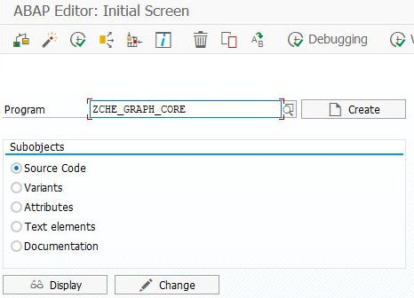
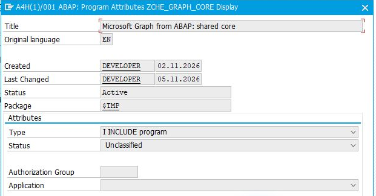
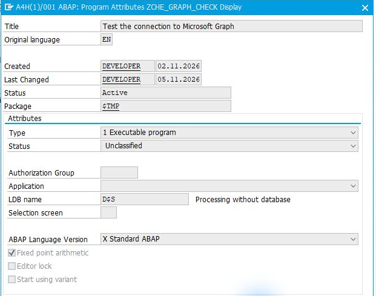
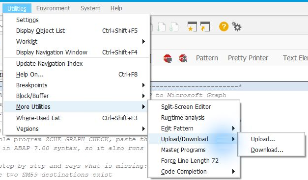
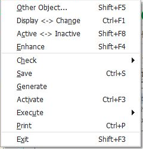

# Installing the ABAP files in SAP

[Main guide](../../WALKTHROUGH.md) · **English** | [Türkçe](install.tr.md)

The ABAP sources are in the [src folder](../../src). The table below lists the files and installation order for your chosen task. Start in a development or test system.

## 1. Select the files

**First, once for every route:** [`ZCHE_GRAPH_CORE`](../../src/zche_graph_core.prog.abap), type **Include program**. This is the shared helper code used by the other files; it has no screen to run on its own.

Then install **only your chosen row** below, from left to right. The file links open the source code.

| Task | First: helper files — Include program | Then: the screen to run — Executable program |
| --- | --- | --- |
| Teams notification | [ZCHE_GRAPH_TEAMS_LIB](../../src/zche_graph_teams_lib.prog.abap) | [ZCHE_GRAPH_TEAMS](../../src/zche_graph_teams.prog.abap) |
| Calendar / Teams meeting | [ZCHE_GRAPH_CALENDAR_LIB](../../src/zche_graph_calendar_lib.prog.abap) | [ZCHE_GRAPH_CALENDAR](../../src/zche_graph_calendar.prog.abap) |
| E-mail | [ZCHE_GRAPH_MAIL_LIB](../../src/zche_graph_mail_lib.prog.abap) | [ZCHE_GRAPH_MAIL](../../src/zche_graph_mail.prog.abap) |
| Supplied Files screen | [ZCHE_GRAPH_MAIL_LIB](../../src/zche_graph_mail_lib.prog.abap), then [ZCHE_GRAPH_FILES_LIB](../../src/zche_graph_files_lib.prog.abap) | [ZCHE_GRAPH_FILES](../../src/zche_graph_files.prog.abap) |
| Excel cells | [ZCHE_GRAPH_FILES_LIB](../../src/zche_graph_files_lib.prog.abap), then [ZCHE_GRAPH_EXCEL_LIB](../../src/zche_graph_excel_lib.prog.abap) | [ZCHE_GRAPH_EXCEL](../../src/zche_graph_excel.prog.abap) |
| SharePoint lists | [ZCHE_GRAPH_LISTS_LIB](../../src/zche_graph_lists_lib.prog.abap) | [ZCHE_GRAPH_LISTS](../../src/zche_graph_lists.prog.abap) |
| Users and groups | [ZCHE_GRAPH_USERS_LIB](../../src/zche_graph_users_lib.prog.abap) | [ZCHE_GRAPH_USERS](../../src/zche_graph_users.prog.abap) |

To check the Graph connection, also add [`ZCHE_GRAPH_CHECK`](../../src/zche_graph_check.prog.abap) as an **Executable program**. Skip this if you only want Teams channel notifications.

**Example — Excel only:** shared helper + Files library + Excel library + Excel screen. You can also add the connection-check screen. The Mail, Calendar and Teams files are not installed.

## 2. Transfer each file into SE38

### A. Set the program name and type

1. Open the source link above. On GitHub, select **Raw** to view the plain code; copy all of it.
2. Open **SE38** in SAP. Enter the exact program name from the table and choose **Create** for a first installation. If the program already exists, open it with **Change** instead.

*Example for the first file. Use the name of the relevant file from the table for each program.*

3. Enter a title. Set **Type** as listed: **I — Include program** for helper files, **1 — Executable program** for the screen you will run.

*The shared helper is an Include. This image shows an existing program's attributes in A4H/001.*

*Executable screen example: the connection-check program. These are also the attributes of an existing program.*

4. Save to your own development package. The `$TMP` shown in the images is for local testing; a package and transport are needed to move the work to other SAP systems.

### B. Transfer the source

5. Paste the complete code into the source editor and save. If you downloaded a `.abap` file to your computer, you can instead use **Utilities → More Utilities → Upload/Download → Upload**.

*File-upload menu. Download the raw ABAP source, rather than saving the GitHub page as HTML.*

### C. Activate and open the screen

6. Save the helper files first; activate the executable program last with **Ctrl+F3**. If SAP asks, select its includes too.

*Location of the activation command. This image is not an activation result.*

7. Open the executable program with **F8**. If its selection screen appears, the files are installed; return to your chosen route for connection and access preparation.

When updating an existing installation, update the shared file and your selected module files from **the same version**. Check the version near the start of each source file; do not mix versions.

## If you get stuck

| Situation | What to do |
| --- | --- |
| Include not found | Save the required helper file in the order above. |
| SAP asks you to select a main program | Select the executable program in the table that uses this include. |
| Long lines are cut off | Disable the editor's forced 72-character line length and transfer the complete source again. |
| You cannot create or activate programs | Give the file list to your SAP developer. |

[Return to task selection](../../WALKTHROUGH.md#1-what-would-you-like-to-do)
