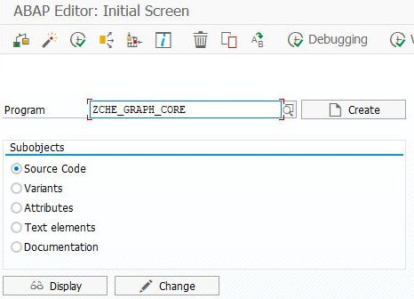
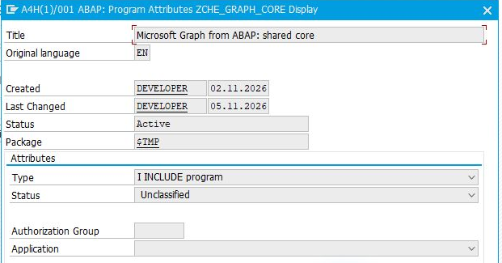
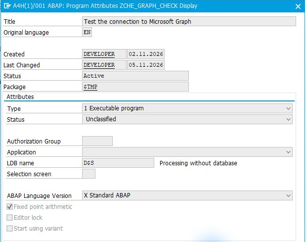
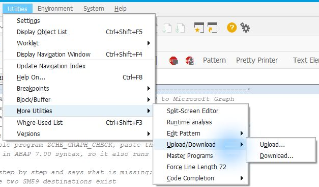
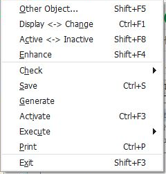

# ABAP dosyalarının SAP’ye kurulumu

[Ana rehber](../../WALKTHROUGH.tr.md)

ABAP kaynakları [src klasöründe](../../src) yer alır. Aşağıdaki tablo, seçtiğiniz işlem için gereken dosyaları ve kurulum sırasını gösterir. İlk kurulumu geliştirme veya test sisteminde yapın.

## 1. Dosyaları seçin

**Önce her yol için bir kez:** [`ZCHE_GRAPH_CORE`](../../src/zche_graph_core.prog.abap), tür **Include program**. Bu, diğer dosyaların kullandığı ortak yardımcı koddur; tek başına çalıştırılacak bir ekranı yoktur.

Ardından aşağıda **yalnız seçtiğiniz satırı**, soldan sağa kurun. Dosya bağlantıları kaynak kodunu açar.

| İhtiyaç | Önce: yardımcı dosyalar — Include program | Sonra: açacağınız ekran — Executable program |
| --- | --- | --- |
| Teams bildirimi | [ZCHE_GRAPH_TEAMS_LIB](../../src/zche_graph_teams_lib.prog.abap) | [ZCHE_GRAPH_TEAMS](../../src/zche_graph_teams.prog.abap) |
| Takvim / Teams toplantısı | [ZCHE_GRAPH_CALENDAR_LIB](../../src/zche_graph_calendar_lib.prog.abap) | [ZCHE_GRAPH_CALENDAR](../../src/zche_graph_calendar.prog.abap) |
| E-posta | [ZCHE_GRAPH_MAIL_LIB](../../src/zche_graph_mail_lib.prog.abap) | [ZCHE_GRAPH_MAIL](../../src/zche_graph_mail.prog.abap) |
| Hazır Dosyalar ekranı | [ZCHE_GRAPH_MAIL_LIB](../../src/zche_graph_mail_lib.prog.abap), ardından [ZCHE_GRAPH_FILES_LIB](../../src/zche_graph_files_lib.prog.abap) | [ZCHE_GRAPH_FILES](../../src/zche_graph_files.prog.abap) |
| Excel hücreleri | [ZCHE_GRAPH_FILES_LIB](../../src/zche_graph_files_lib.prog.abap), ardından [ZCHE_GRAPH_EXCEL_LIB](../../src/zche_graph_excel_lib.prog.abap) | [ZCHE_GRAPH_EXCEL](../../src/zche_graph_excel.prog.abap) |
| SharePoint listeleri | [ZCHE_GRAPH_LISTS_LIB](../../src/zche_graph_lists_lib.prog.abap) | [ZCHE_GRAPH_LISTS](../../src/zche_graph_lists.prog.abap) |
| Kullanıcılar ve gruplar | [ZCHE_GRAPH_USERS_LIB](../../src/zche_graph_users_lib.prog.abap) | [ZCHE_GRAPH_USERS](../../src/zche_graph_users.prog.abap) |

Graph bağlantısını kontrol etmek için ayrıca [`ZCHE_GRAPH_CHECK`](../../src/zche_graph_check.prog.abap) dosyasını **Executable program** olarak ekleyin. Yalnız Teams bildirimi kuruyorsanız bunu atlayın.

**Örnek — yalnız Excel:** ortak yardımcı dosya + Files kütüphanesi + Excel kütüphanesi + Excel ekranı. Bağlantı kontrol ekranı da eklenebilir. E-posta, Takvim ve Teams dosyaları kurulmaz.

## 2. Her dosyayı SE38’e aktarın

### A. Program adını ve türünü belirleyin

1. Yukarıdaki kaynak bağlantısını açın. GitHub’da **Raw** ile ham kodu görüntüleyin; kodun tamamını kopyalayın.
2. SAP’de **SE38** açın. Program adına tablodaki adı aynen yazın ve ilk kurulumda **Create / Oluştur** seçin. Program zaten varsa yeni oluşturmak yerine **Change / Değiştir** ile açın.

*İlk dosya örneği. Her dosyada yukarıdaki tablodan o dosyanın adını kullanın.*

3. Başlık girin. **Type / Tür** alanını tablodaki gibi seçin: yardımcı dosyalarda **I — Include program**, çalıştıracağınız ekranda **1 — Executable program**.

*Ortak yardımcı dosyanın türü: Include. Görsel, A4H/001’de mevcut programın özelliklerini gösterir.*

*Çalıştırılabilir ekran örneği: bağlantı kontrol programı. Bu görsel de mevcut programın özellikleridir.*

4. Kendi geliştirme paketinize kaydedin. Görsellerdeki `$TMP`, yerel test içindir; diğer SAP sistemlerine taşımak için paket ve transport gerekir.

### B. Kaynağı aktarın

5. Kaynak editörüne kodun tamamını yapıştırıp kaydedin. Dosyayı bilgisayarınıza `.abap` olarak indirdiyseniz alternatif olarak **Utilities → More Utilities → Upload/Download → Upload** menüsünden yükleyebilirsiniz.

*Dosyadan yükleme yolu. İndirdiğiniz dosya ham ABAP kaynağı olmalı; GitHub sayfasını HTML olarak kaydetmeyin.*

### C. Etkinleştirip ekranı açın

6. Yardımcı dosyaları önce kaydedin; en son çalıştırılabilir programı **Ctrl+F3** ile etkinleştirin. SAP sorarsa ilgili include’ları da seçin.

*Etkinleştirme menüsünün yeri. Bu görüntü bir etkinleştirme sonucu değildir.*

7. Çalıştırılabilir programı **F8** ile açın. Seçim ekranı geliyorsa dosya kurulumunu tamamladınız; bağlantı ve izin hazırlığı için kendi yolunuza dönün.

Mevcut kurulumu güncelliyorsanız **aynı sürüme ait** ortak dosyayı ve kullandığınız modül dosyalarını birlikte güncelleyin. Kaynak dosyanın ilk satırlarındaki sürümü kontrol edin; farklı sürümleri karıştırmayın.

## Takıldığınızda

| Durum | Yapılacak |
| --- | --- |
| Include bulunamadı | Yukarıdaki sırada gereken yardımcı dosyayı kaydedin. |
| SAP bir ana program seçmenizi istiyor | Bu include’u kullanan, tablodaki çalıştırılabilir programı seçin. |
| Uzun satırlar kesiliyor | Editör ayarlarında 72 karaktere zorlama seçeneğini kapatın; tam kaynağı yeniden aktarın. |
| Oluşturma / etkinleştirme yetkiniz yok | Dosya listesini SAP geliştiricinize iletin. |

[Hedef seçimine dön](../../WALKTHROUGH.tr.md#1-ne-yapmak-istiyorsunuz)
