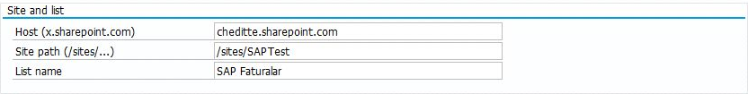
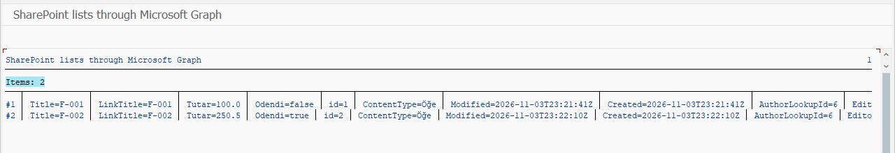
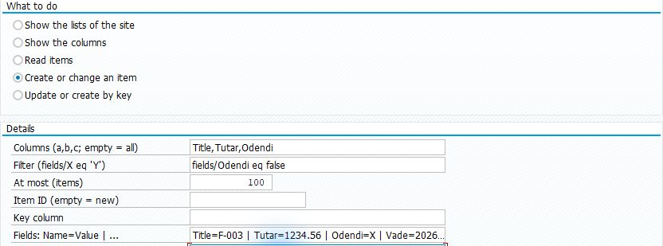
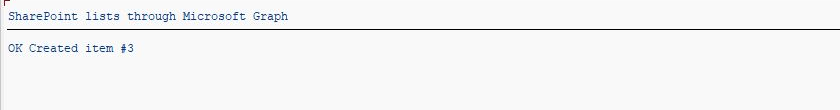
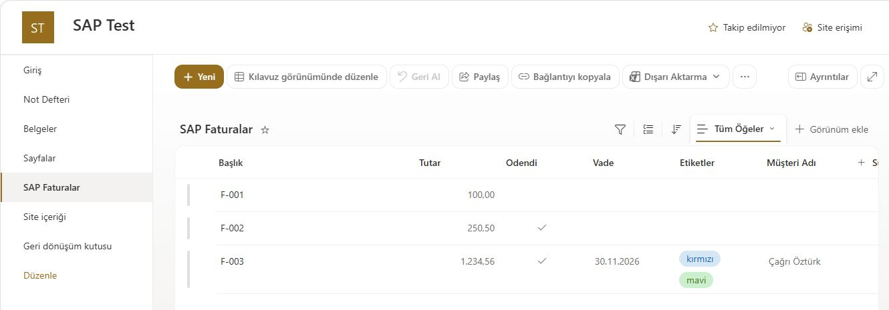

# Reading and changing SharePoint list records from SAP

[Main guide](../../WALKTHROUGH.md) · **English** | [Türkçe](lists.tr.md)

The Lists section reads and updates SharePoint **List** records from SAP. Read a sample list first; then, if needed, add a test record and check it in SharePoint. These operations apply to SharePoint lists; Excel cells have their own section.

## 1. Prepare the connection and sample list

Have the [Graph connection](connection.md) ready. Your Microsoft administrator grants `Sites.Selected` and separate access to the chosen site. A write trial needs write access to that site. Ask the site owner to prepare a list with a few test records.

## 2. Add the files

[SE38 order](install.md): `ZCHE_GRAPH_CORE` → `ZCHE_GRAPH_LISTS_LIB` → `ZCHE_GRAPH_LISTS`. The Files and Excel modules are not required.

## 3. Read the list in SAP

**SE38 → ZCHE_GRAPH_LISTS → F8**. Enter your Tenant and SM59 values. For the site:

| Field | What to enter |
| --- | --- |
| Host | Your own `yourcompany.sharepoint.com` host |
| Site path | Your site's path, for example `/sites/Finance` |
| List name | The list's displayed name in SharePoint |
| Operation | **Read items** |
| Columns, Filter | Empty for the first trial |
| At most | `5` |

*Address and list field locations. The list on the SAP Test site belongs to this trial; use your own host, site path and list name.*

After **F8**, expect the sample records.

*Two records were read from the test list. Additional columns on the right are cut off by the view width.*

## 4. If you want to add a record

First use **Show the columns** to find the columns' actual field names. Then select **Create or change an item**. Leave **Item ID** empty for a new record; enter, for example, `Title=SAP test` in **Fields**. This example is sufficient only if the list has a `Title` field and no other required fields.

*New-record input example. The image contains fields for a more detailed test record; fill your own list's required fields.*

**F8 creates a real record.** Note the returned item number and check the same row in SharePoint. Entering an existing ID changes that record.

*The new record's ID was 3 in this test. Do not use that number as a fixed value for your own trial.*

*Microsoft-side check: the created F-003 record appears in the list.*

[Column types, update-by-key and technical usage](../../TECHNICAL.md#sharepoint-lists)
