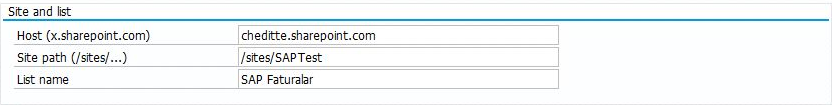
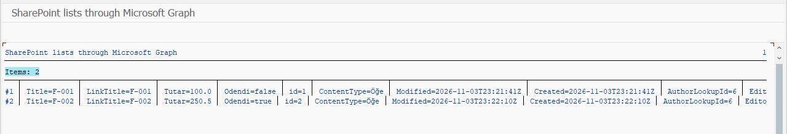
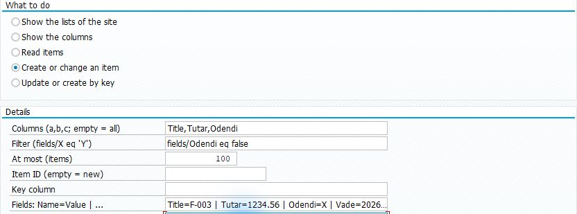
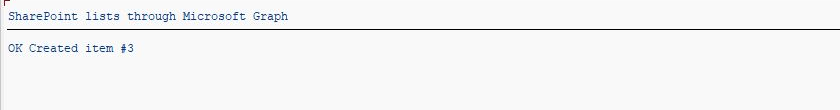
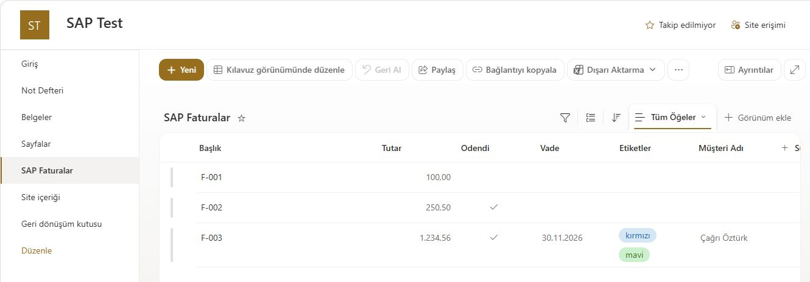

# SharePoint listesindeki kayıtları SAP’den okumak ve değiştirmek

[Ana rehber](../../WALKTHROUGH.tr.md)

Listeler bölümü, SharePoint **Liste / List** kayıtlarını SAP’den okumak ve güncellemek için kullanılır. Önce örnek bir listeyi okuyun; ardından gerekirse test kaydı ekleyip sonucu SharePoint’te kontrol edin. Bu işlemler SharePoint listeleri içindir; Excel hücreleri ayrı bölümde ele alınır.

## 1. Bağlantıyı ve örnek listeyi hazırlayın

[Graph bağlantısı](connection.tr.md) hazır olsun. Microsoft yöneticiniz `Sites.Selected` ve kullanılacak siteye ayrıca erişim tanımlar. Yazma denemesi yapılacaksa siteye yazma erişimi gerekir. Site sahibi, içinde birkaç test kaydı olan bir liste hazırlasın.

## 2. Dosyaları ekleyin

[SE38 sırası](install.tr.md): `ZCHE_GRAPH_CORE` → `ZCHE_GRAPH_LISTS_LIB` → `ZCHE_GRAPH_LISTS`. Dosyalar ve Excel modülleri gerekmez.

## 3. Listeyi SAP’de okuyun

**SE38 → ZCHE_GRAPH_LISTS → F8**. Tenant ve SM59 değerlerini girin. Site için:

| Alan | Nasıl doldurulur? |
| --- | --- |
| Host | Kendi `sirketiniz.sharepoint.com` hostunuz |
| Site path | Kendi site yolunuz; örneğin `/sites/Finans` |
| List name | SharePoint’te görünen liste adı |
| İşlem | **Read items / Kayıtları oku** |
| Columns, Filter | İlk denemede boş bırakın |
| At most / En çok | `5` |

*Adres ve liste alanlarının konumu. SAP Test sitesindeki liste bu denemeye aittir; kendi host, site yolu ve liste adınızı kullanın.*

**F8** sonrası örnek kayıtları bekleyin.

*Test listesinden iki kayıt okunmuş. Sağdaki ek sütunlar görünüm genişliği nedeniyle kesilmiştir.*

## 4. Bir kayıt eklemek isterseniz

Önce **Show the columns / Sütunları göster** ile sütunların gerçek alan adlarını öğrenin. Ardından **Create or change an item / Kayıt oluştur ya da değiştir** seçin. Yeni kayıt için **Item ID** boş bırakılır; **Fields** alanına örneğin `Title=SAP denemesi` yazılır. Bu örnek yalnız listede `Title` alanı ve başka zorunlu alan yoksa yeterlidir.

*Yeni kayıt girişi örneği. Görselde daha kapsamlı bir test kaydının alanları var; kendi listenizin zorunlu alanlarını doldurun.*

**F8 gerçek kayıt oluşturur.** Dönen kayıt numarasını not edin ve SharePoint’te aynı satırı kontrol edin. Mevcut bir ID girerseniz o kayıt değişir.

*Bu denemede yeni kaydın ID’si 3. Bu numarayı kendi denemeniz için sabit değer olarak kullanmayın.*

*Microsoft tarafındaki kontrol: oluşturulan F-003 kaydı listede görünüyor.*

[Sütun türleri, anahtarla güncelleme ve teknik kullanım](../../TECHNICAL.tr.md#sharepoint-listeleri)
