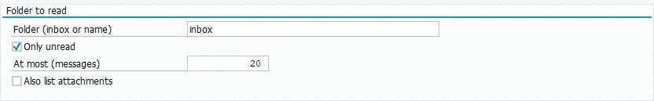
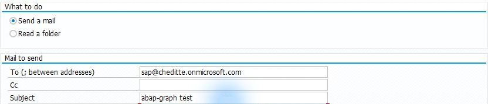
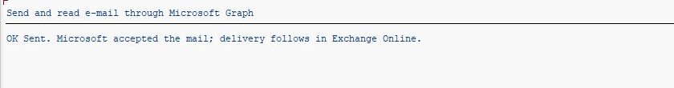
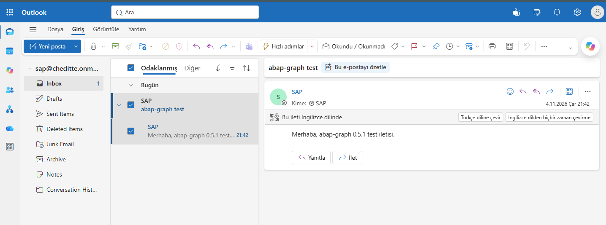

# Sending e-mail and reading an inbox from SAP

[Main guide](../../WALKTHROUGH.md) · **English** | [Türkçe](mail.tr.md)

The Mail section sends and reads messages through a Microsoft 365 mailbox. List the inbox first, then send a test message to an address you control. The same program can also send SAP spool output as a PDF attachment.

## 1. Prepare the mailbox

Set up the [Graph connection](connection.md). Your Microsoft / Exchange administrator prepares the mailbox and application access: `Mail.Send` for sending, `Mail.Read` for reading only, and `Mail.ReadWrite` for marking, moving and uploading large attachments. Restrict access to the mailboxes you will use. [Microsoft permission table](https://learn.microsoft.com/en-us/graph/api/user-list-messages?view=graph-rest-1.0) · [Mailbox restriction options](../../TECHNICAL.md#what-the-e-mail-module-needs-in-addition)

The program uses an application identity, rather than your own e-mail password. To open a shared mailbox **yourself** in Outlook, your personal account also needs separate access to it.

## 2. Add the files

[SE38 order](install.md): `ZCHE_GRAPH_CORE` → `ZCHE_GRAPH_MAIL_LIB` → `ZCHE_GRAPH_MAIL`.

## 3. View the inbox first

**SE38 → ZCHE_GRAPH_MAIL → F8**. Enter your Tenant and SM59 values.

| Field | First trial |
| --- | --- |
| Mailbox | The full address of the mailbox you are authorized to use |
| What to do | Select **Read a folder**; sending may be preselected |
| Folder | `inbox` — the inbox |
| Only unread | Clear for the first trial so messages you already opened can appear too |
| At most | `5` |

*0.5.1 screen showing the field locations. Only unread is selected and the limit is 20 in the image; clear the filter and use 5 for your first trial as described above.*

Run with **F8**. An empty result can mean no matching messages exist; check the selected mailbox in Outlook.

*Read result from the 0.5.1 test. The mailbox address is an example.*

## 4. Send a test message

Select **Send a mail**. Use the same authorized mailbox as sender; enter a test address you control in **To**, `SAP connection test` as subject, and a short message. Leave the spool field empty for this first trial.

*Operation, recipient and subject fields from the 0.5.1 send screen. The test mailbox sends to itself in this example; use an address you control. Enter the message body in Text immediately below.*

**F8 sends a real e-mail.** SAP's `OK Sent` means Microsoft accepted the request; verify delivery separately in the recipient's Outlook inbox.

*Acceptance result in SAP. The Outlook image below shows delivery of the same test message.*

*The actual test message in the shared SAP mailbox.*

To view the shared mailbox, sign in to Outlook with your own work account: **profile picture → Open another mailbox → mailbox address**. It opens using the access granted to your personal account; you do not need a shared-mailbox password.

Seeing the SAP list and the test message delivered in Outlook confirms both directions. [Attachments, PDF and integration with your own process](../../TECHNICAL.md#e-mail-module)
