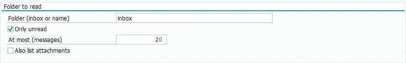
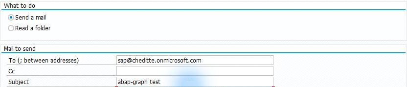
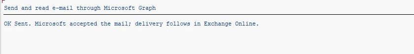
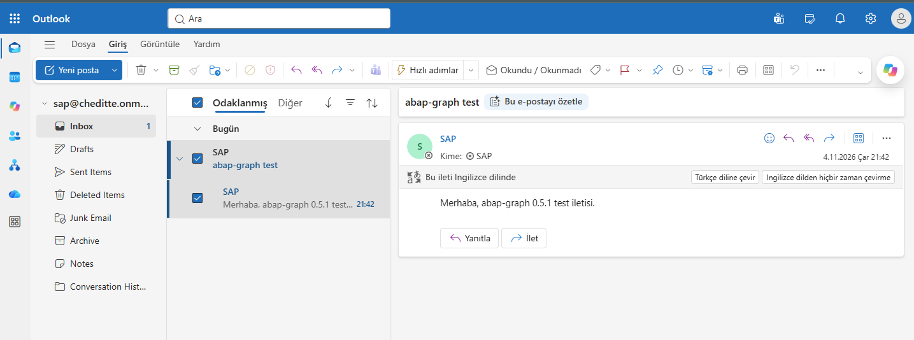

# SAP’den e-posta göndermek ve gelen kutusunu okumak

[Ana rehber](../../WALKTHROUGH.tr.md) · [English](mail.md) | **Türkçe**

E-posta bölümü, Microsoft 365 posta kutusundan ileti göndermek ve gelen iletileri okumak için kullanılır. İlk kullanımda gelen kutusunu listeleyin, ardından kontrol ettiğiniz bir adrese test iletisi gönderin. Aynı program SAP spool çıktısını PDF eki olarak göndermeyi de destekler.

## 1. Posta kutusunu hazırlayın

[Graph bağlantısını](connection.tr.md) kurun. Microsoft / Exchange yöneticiniz kullanılacak posta kutusunu ve uygulama erişimini hazırlasın: gönderme için `Mail.Send`, yalnız okuma için `Mail.Read`; işaretleme, taşıma ve büyük ekleri yükleme için `Mail.ReadWrite` gerekir. Erişimi yalnız kullanılacak kutularla sınırlayın. [Microsoft izin tablosu](https://learn.microsoft.com/en-us/graph/api/user-list-messages?view=graph-rest-1.0) · [Posta kutusu sınırlandırma seçenekleri](../../TECHNICAL.tr.md#e-posta-modülünün-ek-gereksinimleri)

Kendi e-posta parolanızı programa girmezsiniz; uygulama kimliği kullanılır. Microsoft 365 paylaşılan kutusunu Outlook’ta **siz** açacaksanız kişisel hesabınıza ayrıca kutu erişimi verilmelidir.

## 2. Dosyaları ekleyin

[SE38 sırası](install.tr.md): `ZCHE_GRAPH_CORE` → `ZCHE_GRAPH_MAIL_LIB` → `ZCHE_GRAPH_MAIL`.

## 3. Önce gelen kutusunu görün

**SE38 → ZCHE_GRAPH_MAIL → F8**. Tenant ve SM59 değerlerinizi girin.

| Alan | İlk denemede |
| --- | --- |
| Mailbox / Posta kutusu | Kullanımına izin verilen kutunun tam adresi |
| What to do / İşlem | **Read a folder / Klasör oku** seçin; gönderme seçili gelebilir |
| Folder / Klasör | `inbox` — gelen kutusu |
| Only unread / Yalnız okunmamışlar | İlk denemede kaldırın; daha önce açtığınız mesajlar da görünsün |
| At most / En çok | `5` |

*Alanların yerini gösteren 0.5.1 ekranı. Örnekte yalnız okunmamışlar işaretli ve sınır 20; ilk denemenizde yukarıdaki gibi filtreyi kaldırıp 5 kullanın.*

**F8** ile listeleyin. Boş sonuç, kutuda uygun mesaj bulunmadığı anlamına da gelebilir; seçtiğiniz kutuyu Outlook’tan kontrol edin.

*0.5.1 denemesinden okuma sonucu. Görseldeki posta adresi örnektir.*

## 4. Bir test mesajı gönderin

**Send a mail / E-posta gönder** seçin. Aynı yetkili kutuyu gönderen olarak kullanın; **To / Kime** alanına kontrol ettiğiniz bir test adresi, konuya `SAP bağlantı denemesi`, metne kısa bir açıklama girin. İlk denemede spool alanını boş bırakın.

*0.5.1 gönderim ekranından işlem, alıcı ve konu alanları. Örnekte test kutusu kendisine ileti gönderiyor; siz kontrol ettiğiniz adresi kullanın. Mesaj gövdesini hemen alttaki Text alanına yazın.*

**F8 gerçek e-posta gönderir.** SAP’deki `OK Sent` mesajı Microsoft’un isteği kabul ettiğini gösterir; teslimi alıcının Outlook gelen kutusunda ayrıca görün.

*SAP tarafındaki kabul sonucu. Aşağıdaki Outlook görüntüsü aynı test iletisinin teslimini gösterir.*

*Gerçek test iletisinin paylaşılan SAP posta kutusundaki görünümü.*

Paylaşılan kutuyu görmek için kendi iş hesabınızla Outlook’a girin: **profil resmi → Başka bir posta kutusu aç → kutunun adresi**. Paylaşılan kutunun parolasını aramayın; kişisel hesabınıza verilen erişimle açılır.

SAP’deki listeyi ve Outlook’a ulaşan deneme mesajını gördüğünüzde iki yönü de kontrol etmiş olursunuz. [Ekler, PDF ve kendi sürecinize bağlama](../../TECHNICAL.tr.md#e-posta-modülü)
