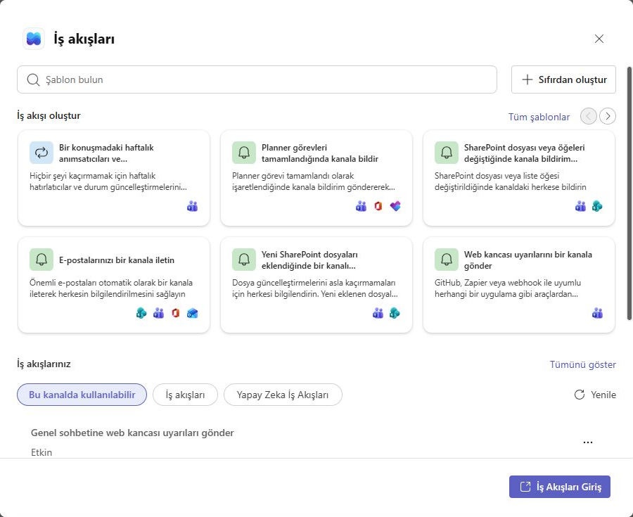
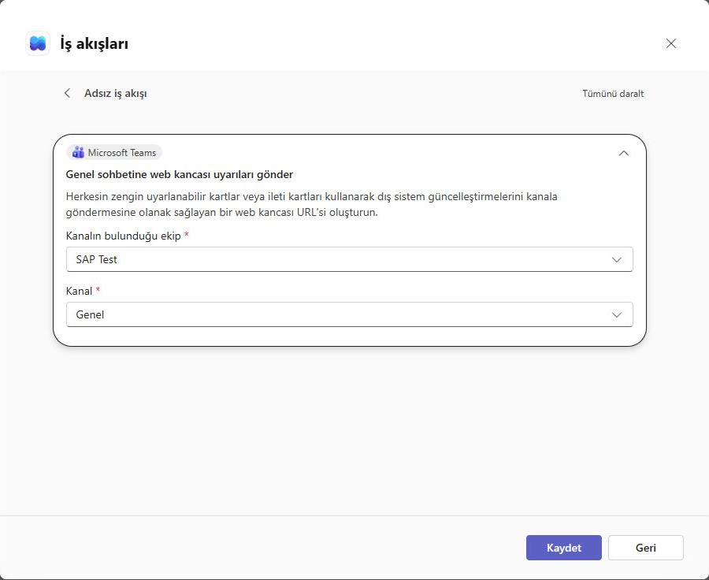
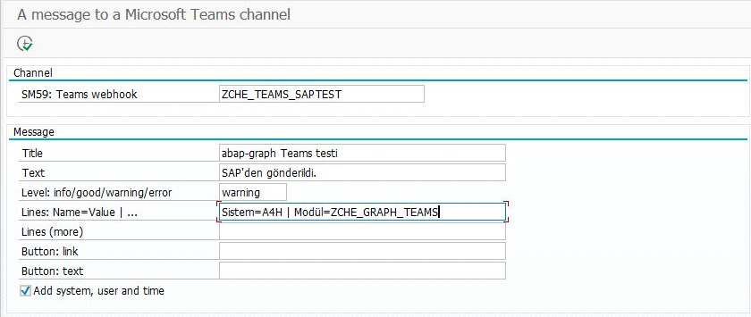
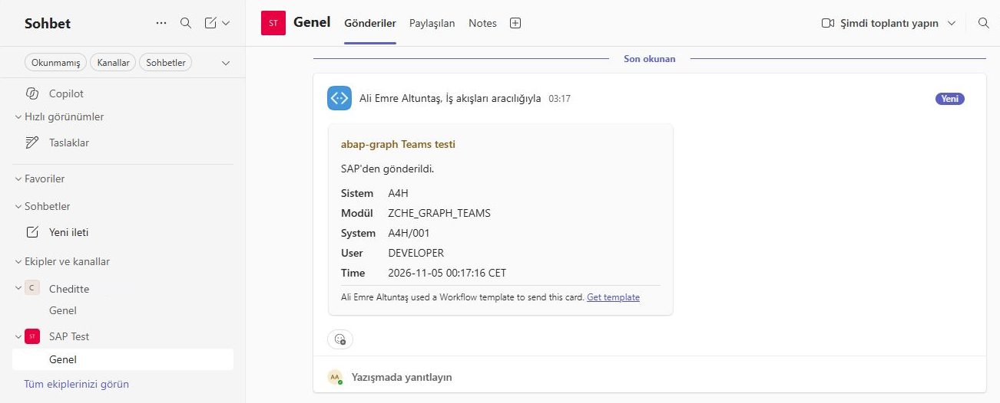

# Sending a message from SAP to a Teams channel

[Main guide](../../WALKTHROUGH.md) · For a meeting link: [Calendar route](calendar.md) · **English** | [Türkçe](teams.tr.md)

Teams notifications deliver information about an SAP operation as a card in a Teams channel. This guide covers connection preparation and the first card. After a successful trial, you can add the same call to your own ABAP report.

Setup order: Teams Workflow → SAP channel connection → three ABAP files → test notification. This route needs no Graph application registration or Graph permissions.

## 1. Prepare the destination channel

Open your team and channel in Teams: **channel's ⋯ menu → Workflows**. Select **Send webhook alerts to a channel**. Check the team and channel, then save. If the menu is unavailable, search for the same template in the Workflows app. [Microsoft's illustrated steps](https://support.microsoft.com/en-au/workflows/send-messages-in-teams-using-incoming-webhooks)

*Template selection. Start with the webhook-alert card at the lower right. Your workflows at the bottom lists previously saved flows.*

*Selection before saving. SAP Test and Genel are examples; choose your own channel.*

The resulting **webhook URL** is the secret address SAP will send card data to. This module does not send a user sign-in/token, so the flow's caller setting must allow this method: an **Anyone** flow invoked through its secret URL. If your organization does not permit this, discuss it with your administrator. Do not share the URL or include it in images.

## 2. Store the secret URL in an SAP connection

In SM59, create a **type G** destination, for example **`ZCHE_TEAMS_SAPTEST`**:

| Field | Value to enter |
| --- | --- |
| Target Host | Your webhook's host name, without `https://` or `:443` |
| Service No. | `443` |
| Path Prefix | From the first `/` after the host, **everything remaining**, including the query after `?` |
| Logon & Security | **Do Not Use a User**; SSL **Active**; suitable SSL Client PSE |

Do not truncate the URL. If the full path does not fit, do not continue with an incomplete value. Ask your SAP administrator to check certificates/proxy settings. Do not capture this screen; the program only needs the destination's **name**.

## 3. Install only these three files

Follow the [SE38 transfer steps](install.md):

1. `ZCHE_GRAPH_CORE` — Include program.
2. `ZCHE_GRAPH_TEAMS_LIB` — Include program.
3. `ZCHE_GRAPH_TEAMS` — Executable program.

## 4. Send the first card

Open **SE38 → ZCHE_GRAPH_TEAMS → F8**:

| Screen field | First trial |
| --- | --- |
| SM59: Teams webhook | The destination name created in the previous step |
| Title | `SAP connection test` |
| Text | `This message was sent from SAP.` |
| Level | `info`; use `warning` for a yellow warning heading |
| Lines | Optional: `Operation=Test \| Result=Completed` |
| Add system, user and time | Select if you want these details on the test card |

*0.7.2 input screen, not a send result. The link-button fields can stay empty for the first trial.*

**F8 sends a real card.** Check SAP's acceptance message, then look for the delivered card in the Teams channel.

*Card delivered in the 0.7.2 test. The time label in this older version was fixed in 0.7.3; the organization name was changed to Cheditte.*

The trial is complete when the message appears in your channel. To use it in a business process, an ABAP developer can add the call to the relevant program. A job's final step does not automatically report a failure in an earlier step. [Technical usage](../../TECHNICAL.md#teams-channel-messages)
