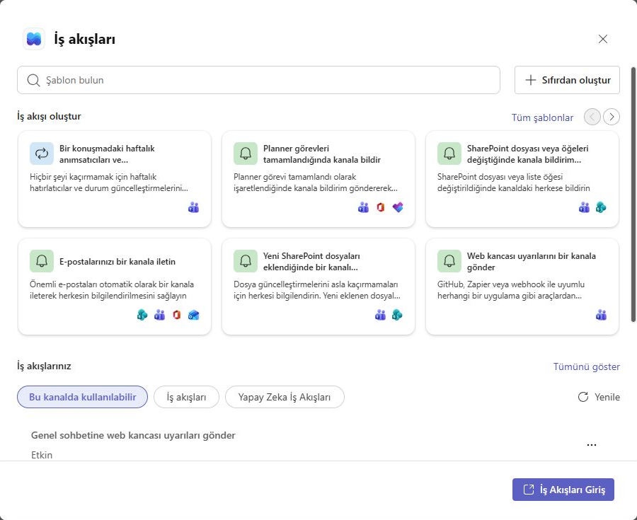
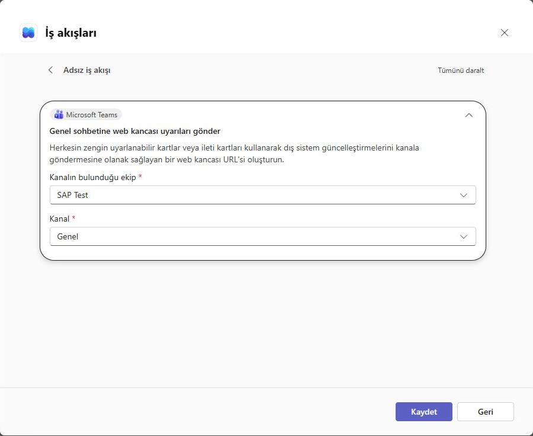
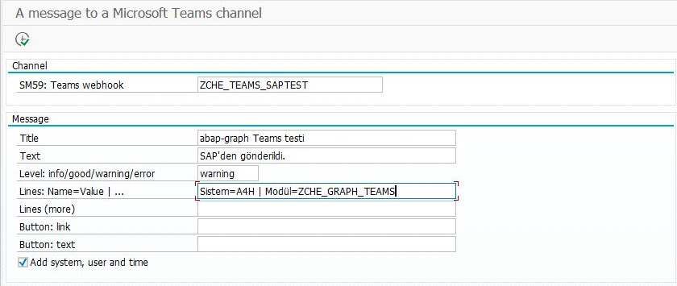
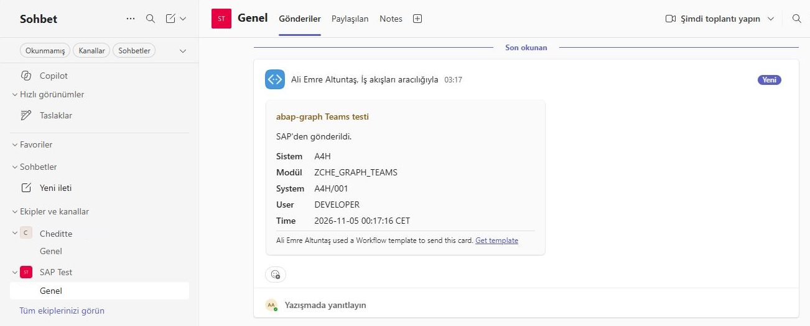

# SAP’den Teams kanalına mesaj göndermek

[Ana rehber](../../WALKTHROUGH.tr.md) · Toplantı bağlantısı için: [Takvim yolu](calendar.tr.md) · [English](teams.md) | **Türkçe**

Teams bildirimi, SAP’deki bir işlemin bilgisini Teams kanalına kart olarak iletmek için kullanılır. Bu rehber, bağlantının hazırlanmasını ve ilk kartın gönderilmesini açıklar. Başarılı denemeden sonra aynı çağrı kendi ABAP raporunuza eklenebilir.

Kurulum sırası: Teams İş Akışı → SAP kanal bağlantısı → üç ABAP dosyası → test bildirimi. Bu bölüm için Graph uygulama kaydı ve Graph izinleri gerekmez.

## 1. Kartın gideceği kanalı hazırlayın

Teams’te ekibinizi ve kanalı açın: **kanalın ⋯ menüsü → Workflows / İş akışları**. **Send webhook alerts to a channel / Kanala web kancası uyarıları gönder** şablonunu seçin. Ekip ve kanalınızı kontrol edip kaydedin. Menü görünmüyorsa İş akışları uygulamasından aynı şablonu arayın. [Microsoft’un görselli adımları](https://support.microsoft.com/en-au/workflows/send-messages-in-teams-using-incoming-webhooks)

*Şablon seçim ekranı. Sağ alttaki “Web kancası uyarılarını bir kanala gönder” kartıyla başlayın. Alttaki İş akışlarınız bölümü daha önce kaydedilen akışları gösterir.*

*Kayıt öncesi seçim ekranı. SAP Test ve Genel örnektir; kendi kanalınızı seçin.*

Oluşan **webhook adresi**, SAP’nin karta ait bilgiyi göndereceği gizli bağlantıdır. Bu modül kullanıcı oturumu/token göndermediği için akışın çağıran ayarı buna uygun olmalıdır; bu yöntem için **Anyone / Herkes** kabul eden, gizli adresle çağrılan akış gerekir. Kuruluşunuz buna izin vermiyorsa yöneticinizle değerlendirin. Adresi paylaşmayın veya görsellere koymayın.

## 2. Gizli adresi SAP bağlantısına koyun

SM59’da örneğin **`ZCHE_TEAMS_SAPTEST`** adlı, **G tipi** bir hedef oluşturun:

| Alan | Girilecek değer |
| --- | --- |
| Target Host | Kendi webhook adresinizin sunucu adı; `https://` ve `:443` olmadan |
| Service No. | `443` |
| Path Prefix | Sunucu adından sonraki ilk `/` ile başlayarak **geri kalan tamamı**, `?` sonrası dahil |
| Logon & Security | **Do Not Use a User**; SSL **Active**; uygun SSL Client PSE |

Adresi kesmeyin. Yol alanına tamamı sığmıyorsa bu haliyle devam etmeyin. Sertifika/proxy ayarını SAP yöneticiniz kontrol etsin. Bu ekranın görüntüsünü almayın; program yalnız hedefin **adını** ister.

## 3. Yalnız bu üç dosyayı kurun

[SE38’e aktarma adımlarını](install.tr.md) izleyin:

1. `ZCHE_GRAPH_CORE` — Include program.
2. `ZCHE_GRAPH_TEAMS_LIB` — Include program.
3. `ZCHE_GRAPH_TEAMS` — Executable program.

## 4. İlk kartı gönderin

**SE38 → ZCHE_GRAPH_TEAMS → F8** ile ekranı açın:

| Ekrandaki alan | İlk denemede |
| --- | --- |
| SM59: Teams webhook | Bir önceki adımda oluşturduğunuz hedefin adı |
| Title / Başlık | `SAP bağlantı denemesi` |
| Text / Metin | `Bu mesaj SAP’den gönderildi.` |
| Level / Düzey | `info`; sarı uyarı başlığı için `warning` |
| Lines / Satırlar | İsteğe bağlı: `İşlem=Deneme \| Sonuç=Tamamlandı` |
| Add system, user and time | Test kartına sistem/kullanıcı/saat eklemek istiyorsanız işaretleyin |

*0.7.2 giriş ekranı; gönderim sonucu değildir. Bağlantı butonu alanları ilk denemede boş kalabilir.*

**F8** gerçek bir kart gönderir. SAP’de kabul mesajını, ardından Teams kanalında kartın geldiğini kontrol edin.

*0.7.2 denemesinde teslim edilen kart. Bu eski sürümdeki saat etiketi 0.7.3’te düzeltildi; kuruluş adı Cheditte olarak düzenlendi.*

Mesajı kendi kanalınızda gördüğünüzde bu denemeyi tamamlamış olursunuz. Kendi sürecinizde kullanmak için bir ABAP geliştiricisi çağrıyı ilgili programa ekleyebilir. Bir job’ın son adımı olarak kullanmak, önceki adımda iptal olan job’ın hatasını kendiliğinden bildirmez. [Teknik kullanım](../../TECHNICAL.tr.md#teams-kanal-mesajları)
