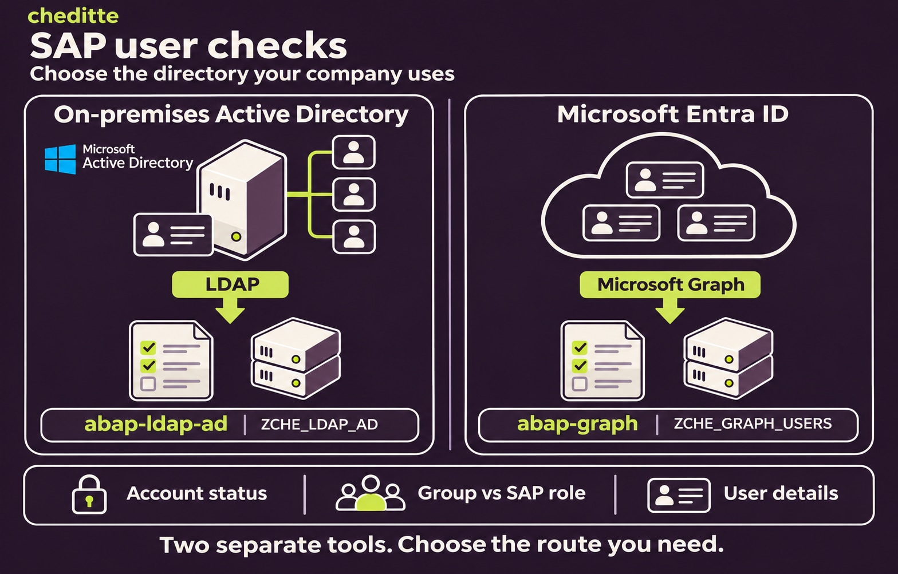
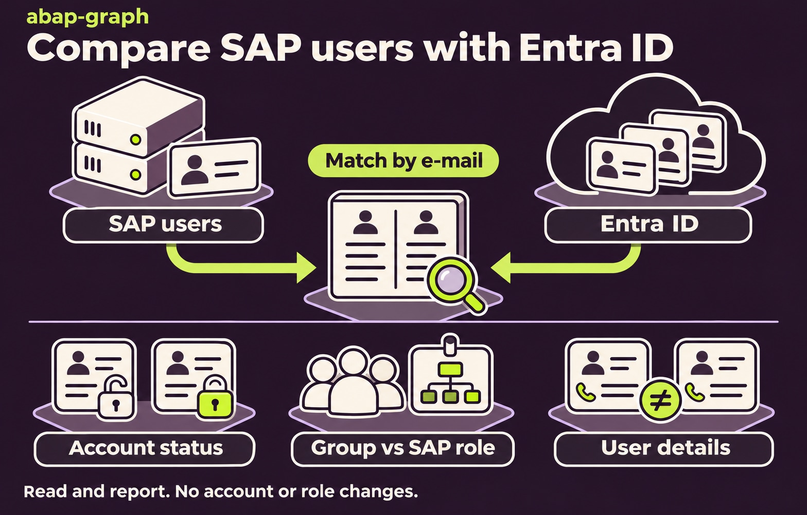

# Entra ID users and SAP checks

[Main guide](../../WALKTHROUGH.md) · **English** | [Türkçe](users.tr.md)

Use `ZCHE_GRAPH_USERS` to see Microsoft users in SAP and compare them with SAP accounts, roles and user details. For example: a Microsoft account is closed but its SAP user is still active, or a group member has no matching SAP role. **The program reports differences; it does not change accounts, roles or contact details.** These options belong to the existing Users module; there is no additional comparison program to install.

## Choose the directory

| Where are your users managed? | Route |
| --- | --- |
| **Microsoft Entra ID**, the cloud directory | Continue here: `ZCHE_GRAPH_USERS` reads through Microsoft Graph. |
| **On-premises Active Directory**, inside your organization's network | The separate `ZCHE_LDAP_AD` program uses SAP's LDAP connector. Its [abap-ldap-ad repository](https://github.com/Cheditte/abap-ldap-ad) is currently private; the link is available only to authorized collaborators. |

**The Active Directory tool** includes account status, group–role and contact-detail checks, plus directory search. It is not an LDAP feature inside Graph. The two projects have separate code and installation; they do not compare SAP, AD and Entra ID together. Choose the route for the directory you want to check.

The AD tool also has a separately confirmed SAP user-locking option. **Graph has no locking option.** Similar comparison goals do not mean that every feature or matching rule is identical.

## 1. Prepare access

Set up the [Graph connection](connection.md). Your Microsoft administrator evaluates and consents to `User.Read.All` application permission for users and `GroupMember.Read.All` for group members. These grant access to organization user/group information, without mail or file permissions.

For SAP comparisons, the person running the program also needs permission to display the selected SAP user groups (`S_USER_GRP`, activity `03`). The group–role check additionally checks display permission for that role (`S_USER_AGR`, activity `03`). Ask your SAP authorization administrator to prepare this access. The new comparisons use the existing Microsoft read permissions; no sign-in-history permission is needed.

## 2. Add the files

[SE38 order](install.md): `ZCHE_GRAPH_CORE` → `ZCHE_GRAPH_USERS_LIB` → `ZCHE_GRAPH_USERS`.

## 3. Get the first list

**SE38 → ZCHE_GRAPH_USERS → F8**. Enter your own connection details in Tenant and SM59:

1. Select **Find users**.
2. Leave **Filter** empty; set **At most** to `5`.
3. Run with **F8**. Compare the returned names and account addresses with your Microsoft environment.

*A4H/001 input example. This selection reads up to five accounts; use your own Tenant and SM59 values.*

*Three-account result captured on 5 November 2026 in A4H/001 with 0.7.4 installed. `disabled` describes the Microsoft account's status; it does not mean the program disabled the account.*

For group members, select **Members of a group** and enter your group's name or ID. **Show a user** retrieves the details of a particular account.

Additional example: listing group members

*Enter your own group in Group when Members of a group is selected. This example uses `SAP Test` and at most five members; User is empty.*

*One member was listed in the same A4H/001 session. This operation does not change group membership.*

Checking names and account addresses is enough for this first trial.

## 4. Compare with SAP

*Illustration of the three checks, not a SAP screenshot or a test result.*

Start with a small set in **SAP users**, using your own test users. People are matched by the e-mail address in **SU01** against Microsoft mail / sign-in addresses. These checks cover SAP **dialog users**. An empty SAP users selection covers all dialog users that the caller may display.

**At most** and **Filter** belong to user search; they do not limit the SAP comparisons. The account and detail checks read the Entra directory to match the selected SAP users.

### A. Check whether accounts are open or closed

1. Select **SAP users: account check** and fill **SAP users**.
2. To check the reverse direction as well, select **Locked in SAP, open in Entra** (`P_REV`). Leave it clear for the normal active-SAP-user check.
3. Run with **F8** and review the findings.

| Finding | What to investigate |
| --- | --- |
| Microsoft account disabled / no Microsoft account | The SAP user is active, but the matching Microsoft account is disabled or missing. Check the address and whether both accounts should remain active. |
| Locked or not valid in SAP, Microsoft account enabled | The optional reverse check found a locked SAP user or one outside its validity dates, while a matching Microsoft account is enabled. Review the reason; the finding does not decide which account should change. |

### B. Compare a group with an SAP role

1. Select **Group against SAP role**.
2. Enter your **Group (name or ID)** and **SAP role**. For example, use your own finance group and its intended SAP role. Select **Include nested groups** only when that is your intended scope.
3. Run with **F8**. Review members without the role, role holders outside the group, and missing SAP matches. A matching SAP user that is locked or not valid now has its own finding: **in the group, the SAP user is locked or not valid** (`sap_locked`).

One run compares one group with one role. Only enabled Microsoft members are considered. A limited SAP user selection or missing display permissions can leave a member without a visible SAP match; interpret findings within that scope. The report never assigns or removes a role.

### C. Compare the details in SU01

1. Select **SU01 against Entra ID** and fill **SAP users**.
2. Run with **F8**. Review differences in first name, last name, department, job title and telephone.
3. Each line shows the SAP value followed by the Entra ID value. The arrow describes the comparison, not a proposed or completed update.

Telephone compares the **last ten digits** of the SU01 number with the **first business phone** in Entra ID. Thus `+90 212 555 01 07` and `0212 555 0107` match. This is a simple comparison rule, not international phone validation; review numbers with different country codes or extensions yourself. Empty Entra values are not listed, and no SAP value is cleared. Details with an address shared by multiple Entra accounts are skipped.

**Read the counts before the findings.** If the report says **SAP users left out: no authorization to display them: N**, the list is incomplete for that selection. SAP users without an e-mail address cannot be matched. An empty findings list alone is not evidence that every user was checked.

## 5. What was tried?

The [validation record](../../VALIDATION.md) documents A4H/001, SAP_BASIS 816 and a Microsoft test tenant on 6–7 November 2026: account status, a locked group member, the reverse option on/off, three SU01 detail differences, reading a business phone, and the excluded-user count. The record reports **42/42 Users unit tests**. These tests were not rerun for this documentation change.

**A differing phone number has only been checked in unit tests**, not as a live tenant difference. The screenshots above are the earlier 0.7.4 lookup screens; screenshots of the new 0.8.0 comparison fields/results have not been added. The source remains an **unreleased 0.8.0 development version**.

For matching rules, permissions and ABAP calls, see [the technical reference](../../TECHNICAL.md#entra-id-users-and-groups). Bulk group–role mappings, alternative matching keys, an ALV screen and last-sign-in reporting are not implemented.
