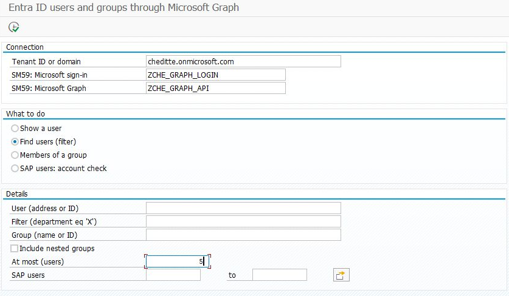
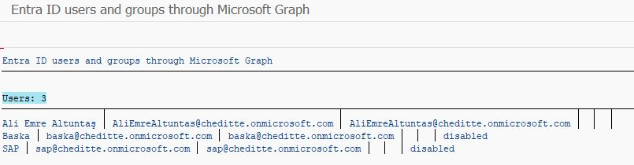
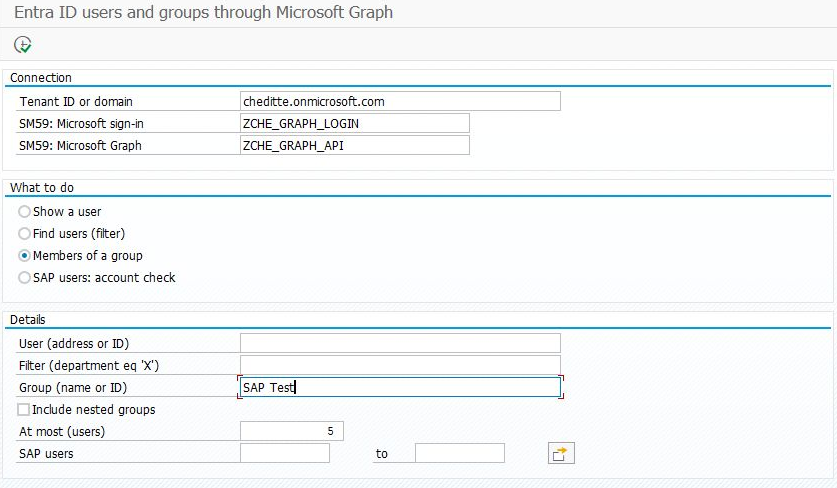
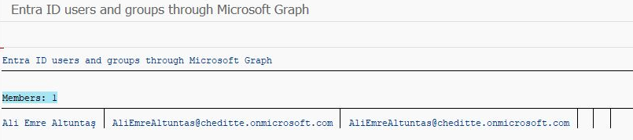

# Listing Microsoft users and group members in SAP

[Main guide](../../WALKTHROUGH.md) · **English** | [Türkçe](users.tr.md)

This section explains how to list Microsoft 365 users and group members in SAP. Read a limited number of accounts first and compare them with the Microsoft-side information. The program only reads; it does not create, delete or disable accounts.

## 1. Prepare access

Set up the [Graph connection](connection.md). Your Microsoft administrator evaluates and consents to `User.Read.All` application permission for users and `GroupMember.Read.All` for group members. These grant access to organization user/group information, without mail or file permissions.

## 2. Add the files

[SE38 order](install.md): `ZCHE_GRAPH_CORE` → `ZCHE_GRAPH_USERS_LIB` → `ZCHE_GRAPH_USERS`.

## 3. Get the first list

**SE38 → ZCHE_GRAPH_USERS → F8**. Enter your own connection details in Tenant and SM59:

1. Select **Find users**.
2. Leave **Filter** empty; set **At most** to `5`.
3. Run with **F8**. Compare the returned names and account addresses with your Microsoft environment.

*A4H/001 input example. This selection reads up to five accounts; use your own Tenant and SM59 values.*

*Three-account result captured on 5 November 2026 in A4H/001 with 0.7.4 installed. `disabled` describes the Microsoft account's status; it does not mean the program disabled the account.*

For group members, select **Members of a group** and enter your group's name or ID. **Show a user** retrieves the details of a particular account.

Additional example: listing group members

*Enter your own group in Group when Members of a group is selected. This example uses `SAP Test` and at most five members; User is empty.*

*One member was listed in the same A4H/001 session. This operation does not change group membership.*

Checking names and account addresses is enough for this first trial.

## 4. Compare with SAP (optional)

Three options compare Microsoft with the SAP users. They only report; nothing is changed.

- **SAP users: account check**: active SAP users whose Microsoft account is disabled or missing.
- **Group against SAP role**: enter a group and an SAP role. The list shows who is in the group but lacks the role, and who has the role but is not in the group.
- **SU01 against Entra ID**: name, department and job title that differ between SU01 and Microsoft.

People are matched by the e-mail address in SU01. The comparisons need extra SAP read authorizations. [Details](../../TECHNICAL.md#entra-id-users-and-groups)

The role and SU01 options are new in 0.8.0 and have not yet been tried in SAP.
