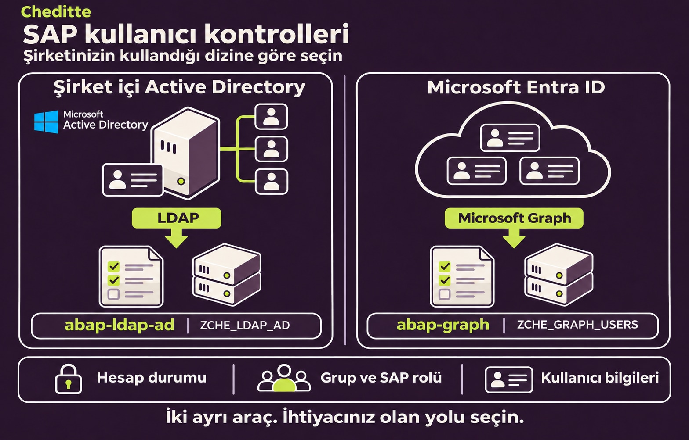
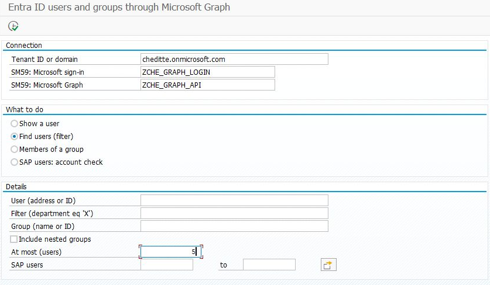
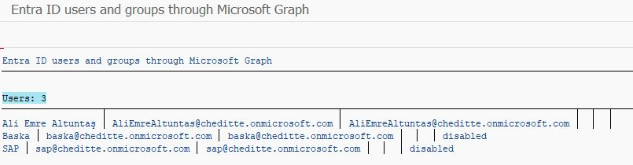
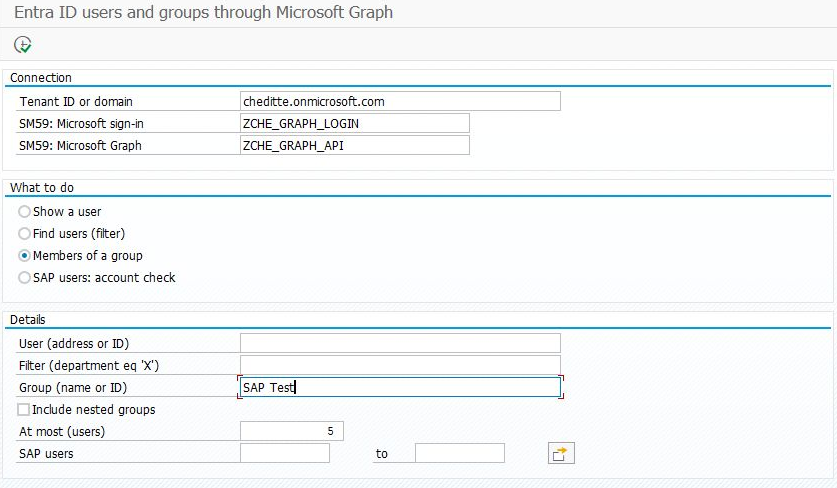
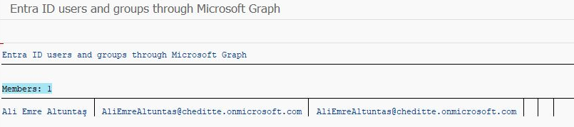
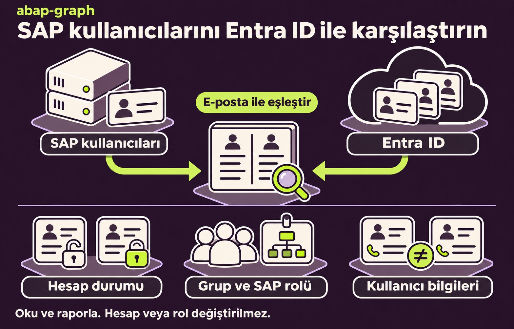

# Entra ID kullanıcıları ve SAP kontrolleri

[Ana rehber](../../WALKTHROUGH.tr.md) · [English](users.md) | **Türkçe**

`ZCHE_GRAPH_USERS` ile Microsoft kullanıcılarını SAP’de görebilir; SAP hesapları, rolleri ve kullanıcı bilgileriyle karşılaştırabilirsiniz. Örneğin Microsoft hesabı kapatılmış bir kişinin SAP hesabı hâlâ açık olabilir ya da bir grup üyesinde beklenen SAP rolü bulunmayabilir. **Program farkları raporlar; hesapları, rolleri veya iletişim bilgilerini değiştirmez.** Bu seçenekler mevcut Kullanıcılar modülündedir; ayrıca bir karşılaştırma programı kurmanız gerekmez.

## Dizin türünü seçin

| Kullanıcılarınız nerede yönetiliyor? | İzleyeceğiniz yol |
| --- | --- |
| **Microsoft Entra ID**, bulut dizini | Bu rehberle devam edin: `ZCHE_GRAPH_USERS`, Microsoft Graph üzerinden okur. |
| **Şirket içi Active Directory**, kurum ağınızda | Ayrı `ZCHE_LDAP_AD` programı SAP’nin LDAP bağlayıcısını kullanır. [abap-ldap-ad deposu](https://github.com/Cheditte/abap-ldap-ad) şu anda özeldir; bağlantı yalnız yetkilendirilmiş katkıcılara açılır. |

**Active Directory aracı**, hesap durumu, grup–rol ve iletişim bilgisi kontrollerinin yanında rehber araması içerir. Graph içine eklenmiş bir LDAP özelliği değildir. İki projenin kodu ve kurulumu ayrıdır; SAP, AD ve Entra ID’yi aynı anda karşılaştırmazlar. Kontrol edeceğiniz dizine uygun yolu seçin.

AD aracında ayrıca onay penceresiyle çalışan bir SAP kullanıcı kilitleme seçeneği bulunur. **Graph’ta kilitleme seçeneği yoktur.** Benzer karşılaştırma amaçları, bütün özelliklerin veya eşleştirme kurallarının aynı olduğu anlamına gelmez.

## 1. Erişimi hazırlayın

[Graph bağlantısını](connection.tr.md) hazırlayın. Microsoft yöneticiniz kullanıcı okuma için `User.Read.All`, grup üyeleri için `GroupMember.Read.All` uygulama izinlerini değerlendirip onaylar. Bunlar kuruluşun kullanıcı/grup bilgilerine erişim sağlar; posta veya dosya izni istemez.

SAP karşılaştırmalarını çalıştıran kişinin, seçilen SAP kullanıcı gruplarını görüntüleme yetkisi de gerekir (`S_USER_GRP`, işlem `03`). Grup–rol kontrolü ayrıca o rolün görüntüleme yetkisini kontrol eder (`S_USER_AGR`, işlem `03`). Bu erişimi SAP yetki yöneticinizle hazırlayın. Yeni karşılaştırmalar mevcut Microsoft okuma izinlerini kullanır; oturum açma geçmişi izni gerekmez.

## 2. Dosyaları ekleyin

[SE38 sırası](install.tr.md): `ZCHE_GRAPH_CORE` → `ZCHE_GRAPH_USERS_LIB` → `ZCHE_GRAPH_USERS`.

## 3. İlk listeyi alın

**SE38 → ZCHE_GRAPH_USERS → F8**. Tenant ve SM59 alanlarına kendi bağlantınızı girin:

1. **Find users / Kullanıcı ara** seçin.
2. **Filter / Filtre** alanını boş bırakın; **At most / En çok** değerini `5` yapın.
3. **F8** ile çalıştırın. Gelen adları ve hesap adreslerini Microsoft ortamınızdakilerle karşılaştırın.

*A4H/001 giriş örneği. Bu seçim en fazla beş hesabı okur; kendi Tenant ve SM59 bilgilerinizi kullanın.*

*5 Kasım 2026’da A4H/001’de, 0.7.4 kurulu oturumda alınan üç hesaplık sonuç. `disabled`, Microsoft hesabının devre dışı olduğunu belirtir; programın hesabı kapattığı anlamına gelmez.*

Grup üyeleri için **Members of a group / Grubun üyeleri** seçip kendi grubunuzun adını veya ID’sini girin. **Show a user / Kullanıcıyı göster** seçeneği belirli hesabın ayrıntılarını getirir.

Ek örnek: grup üyelerini listelemek

*Members of a group seçildiğinde Group alanına kendi grubunuzu girin. Bu örnekte `SAP Test` ve en fazla beş üye seçildi; User alanı boş bırakıldı.*

*Aynı A4H/001 oturumunda grubun bir üyesi listelendi. Bu işlem grup üyeliğini değiştirmez.*

Liste geldiğinde adları ve hesap adreslerini kontrol etmek bu ilk deneme için yeterli.

## 4. SAP ile karşılaştırma

*Üç kontrolü açıklayan çizimdir; SAP ekran görüntüsü veya test sonucu değildir.*

İlk denemede **SAP kullanıcıları** alanına kendi test kullanıcılarınızdan küçük bir seçim girin. Kişiler **SU01**’deki e-posta adresi ile Microsoft’taki posta / oturum açma adresleri üzerinden eşleşir. Bu kontroller SAP **diyalog kullanıcılarını** kapsar. SAP kullanıcıları alanı boşsa çalıştıran kişinin görüntüleyebildiği tüm diyalog kullanıcıları kapsama girer.

**En çok** ve **Filtre** alanları kullanıcı araması içindir; SAP karşılaştırmalarını sınırlamaz. Hesap ve bilgi kontrolleri, seçilen SAP kullanıcılarını eşlemek için Entra dizinini okur.

### A. Hesapların açık veya kapalı olmasını kontrol edin

1. **SAP kullanıcıları: hesap** seçin ve **SAP kullanıcıları** alanını doldurun.
2. Ters yönü de kontrol etmek için **SAP'de kilitli, Entra'da açık** (`P_REV`) kutusunu işaretleyin. Yalnız aktif SAP kullanıcılarını kontrol etmek için kutuyu boş bırakın.
3. **F8** ile çalıştırıp bulguları inceleyin.

| Bulgu | Neyi incelemelisiniz? |
| --- | --- |
| Microsoft hesabı kapalı / Microsoft hesabı yok | SAP kullanıcısı aktif, fakat eşleşen Microsoft hesabı kapalı veya bulunamıyor. Adresi ve iki hesabın da açık kalması gerekip gerekmediğini kontrol edin. |
| SAP'de kilitli ya da geçersiz, Microsoft hesabı açık | İsteğe bağlı ters kontrol, SAP kullanıcısının kilitli veya geçerlilik tarihleri dışında olduğunu, eşleşen Microsoft hesabının ise açık olduğunu buldu. Nedenini inceleyin; bulgu hangi hesabın değişmesi gerektiğine karar vermez. |

### B. Bir grup ile SAP rolünü karşılaştırın

1. **Grup ile SAP rolü** seçin.
2. Kendi **Grup (ad ya da ID)** ve **SAP rolü** bilgilerinizi girin. Örneğin kendi finans grubunuzla ona karşılık gelmesini beklediğiniz SAP rolünü kullanın. **İç içe grupları da al** kutusunu yalnız istediğiniz kapsam buysa seçin.
3. **F8** ile çalıştırın. Rolü eksik grup üyelerini, grubun dışındaki rol sahiplerini ve SAP’de eşleşmeyen üyeleri inceleyin. Eşleşen SAP kullanıcısı kilitli veya geçersizse artık ayrı bulgu gösterilir: **grupta, SAP kullanıcısı kilitli ya da geçersiz** (`sap_locked`).

Bir çalıştırmada bir grup ile bir rol karşılaştırılır. Yalnız açık Microsoft hesapları üye olarak değerlendirilir. SAP kullanıcı seçimi daraltılmışsa veya görüntüleme yetkisi eksikse bir üyenin SAP eşleşmesi görünmeyebilir; bulguları bu kapsam içinde okuyun. Rapor rol atamaz veya kaldırmaz.

### C. SU01’deki bilgileri karşılaştırın

1. **SU01 ile Entra ID** seçin ve **SAP kullanıcıları** alanını doldurun.
2. **F8** ile çalıştırın. Ad, soyad, departman, unvan ve telefon farklarını inceleyin.
3. Her satırda önce SAP, ardından Entra ID değeri görünür. Ok işareti karşılaştırmayı anlatır; önerilmiş veya yapılmış bir güncelleme değildir.

Telefonda SU01 numarası ile Entra ID’deki **ilk iş telefonunun son on rakamı** karşılaştırılır. Böylece `+90 212 555 01 07` ile `0212 555 0107` eşleşir. Bu basit bir karşılaştırma kuralıdır, uluslararası telefon doğrulaması değildir; farklı ülke kodlarını ve dahili numaraları ayrıca değerlendirin. Entra’daki boş değerler listelenmez; SAP’de hiçbir değer silinmez. Adresi birden çok Entra hesabında bulunan kişilerin bilgi karşılaştırması atlanır.

**Bulgulardan önce sayılara bakın.** Raporda **Dışarıda bırakılan SAP kullanıcısı: görüntüleme yetkisi yok: N** yazıyorsa o seçim için liste eksiktir. E-posta adresi olmayan SAP kullanıcıları eşleştirilemez. Bulgu listesinin boş olması, tek başına tüm kullanıcıların kontrol edildiğini göstermez.

## 5. Neler denendi?

[Doğrulama kaydı](../../VALIDATION.tr.md), 6–7 Kasım 2026’da A4H/001, SAP_BASIS 816 ve Microsoft test ortamında şu denemeleri içerir: hesap durumu, kilitli grup üyesi, ters seçeneğin açık/kapalı hâli, üç SU01 bilgi farkı, iş telefonunun okunması ve dışarıda bırakılan kullanıcı sayısı. Kayıtta Kullanıcılar modülünün **42/42 birim testinin** geçtiği belirtilir. Bu belge güncellemesinde testler yeniden çalıştırılmadı.

**Farklı telefon numarası yalnız birim testinde kontrol edildi**; canlı ortamda telefon farkı satırı görülmedi. Yukarıdaki görüntüler eski 0.7.4 arama ekranlarıdır; yeni 0.8.0 karşılaştırma alanlarının/sonuçlarının ekran görüntüleri henüz eklenmedi. Kaynak, **henüz yayımlanmamış 0.8.0 geliştirme sürümüdür**.

Eşleşme kuralları, yetkiler ve ABAP çağrıları için [teknik başvuruya](../../TECHNICAL.tr.md#entra-id-kullanıcıları-ve-grupları) bakın. Toplu grup–rol eşlemeleri, alternatif eşleme anahtarları, ALV ekranı ve son oturum açma raporu henüz uygulanmadı.
